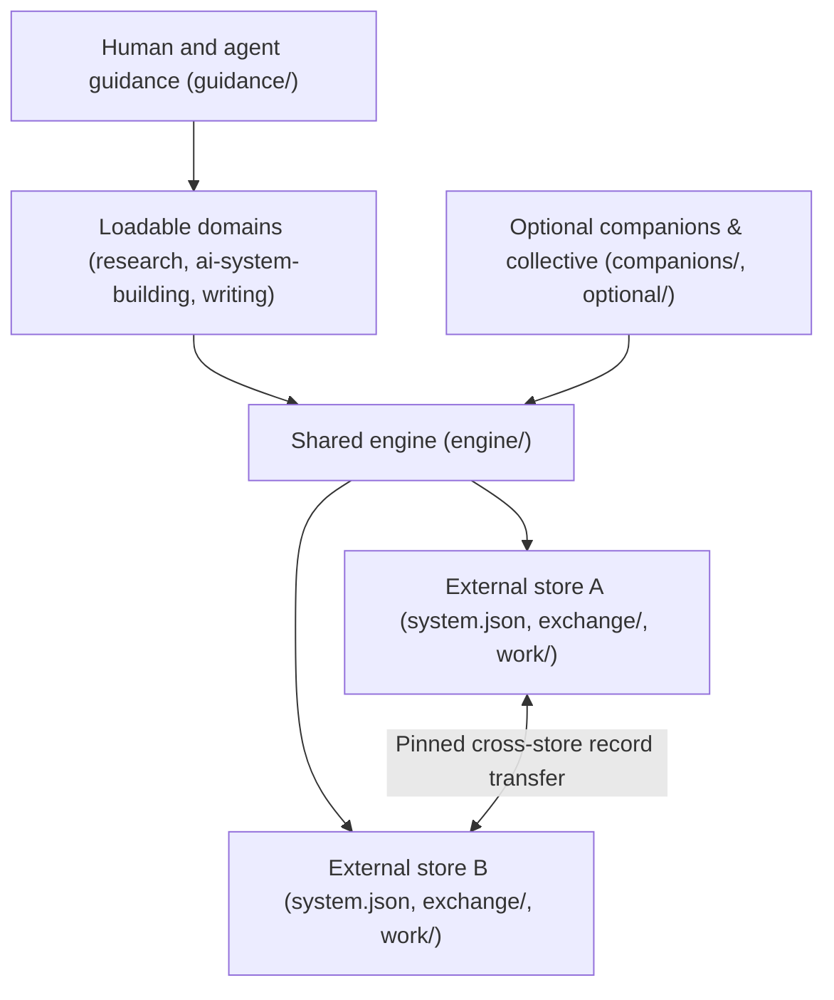

# Architecture

Managed AI separates **one shared engine**, **loadable domain data**, and **independent stores**. A deployment descriptor binds a store to a qualified engine edition without copying engine code or mirroring source corpora.

## Ownership boundaries

| Component | Responsibility |
| --- | --- |
| `engine/deployment/` | Deployment descriptors (`agent-system-deployment/2`), `code_identity()` verification, engine staging/activation, and cross-store owner admission. |
| `engine/core/` | Platform locking/reparse guards, content-addressed object store, packet exchange, attention tracking, return collection, and wire-format constants. |
| `engine/store/` | Native records (`g60-agent-system/0.1`), schema validation, domain/catalogue selection, context capture, `g60-composition/1` views, discovery, graph queries, transfer, and turn retirement. |
| `engine/library/` | Standalone stdlib lexical/BM25/FTS5 knowledge reader, search, and product bundles (isolated from `core`/`store`/`deployment`). |
| `engine/host/` | Continuing-work host, material retention, and signal-field observation queue built on top of native stores. |
| `engine/tools/` & `engine/release/` | Operator helpers, guidance pin refresh, acceptance gate, and self-verifying release packager. |
| `companions/` | Optional adapters: `workbench/` (model/tool callbacks & durable resume), `peer/` (bounded worker harness), `publication_review/` (dependency observation), and `representation/` (structural checks). |
| `optional/collective/` | Optional SQLite-backed multi-owner receiving authority. |
| `domains/*` | Independent Git submodules owning domain schemas, source catalogues, entry guidance, and declared tools. Loading a domain never executes its tools. |
| External stores | Caller-owned directories (`system.json`, `exchange/`, `work/`) outside the engine checkout holding goals, records, packets, and local receiving accounts. |

## Storage, schemas, and retention

- **Store descriptor (`system.json`):** Declares stable `instance_id`, `store_schema` (`managed-ai-store/1`), `engine_api` (`managed-ai-runtime/1`), retention policy (`current-use` default or opt-in `append-history`), and SHA-256-pinned domain and instance catalogue bindings.
- **Record envelope:** Every record carries `id`, `kind`, `content`, `relations`, workspace-relative `basis`, `active` metadata, monotonic `revision`, and canonical `sha256`. Typed kinds are validated against loaded domain JSON schemas on write.
- **Source ownership:** Each canonical source body has one owner. Catalogues bind identity, path, bytes, SHA-256, and exposure (`available` or `sealed`). Sealed entries expose metadata only and are never opened as ordinary sources. Availability, acquisition, receiving, and effective use remain distinct claims.
- **Deployment qualification:** `deployment.json` pins `engine.code_sha256` (and optional `git_commit` provenance) alongside the store's `instance_id`, `engine_api`, and `store_schema`. Code changes require explicit `stage` and `activate` before normal execution.

## Guarded context, recomposition, and transfer

- **Context / receive / adopt:** `system context` captures governing goals, obligations, selected records, techniques, and workspace basis into an immutable turn packet. `system receive` records an attributed participant return and proposals. `system adopt` rechecks captured basis digests and expected revisions before applying a target write.
- **Authored compositions (`g60-composition/1`):** Records may carry `elements`, `relations`, `premises`, and `opportunities` inspected via `system compose` (with optional `--focus`, `--interaction-map`, and `--changed-since`).
- **Guarded recomposition (`system recompose`):** Evaluates a `g60-recomposition/1` proposal against a pinned target revision and nominated source pins, computing affected consumers and read sets before `--accept DIGEST` or `--retain DIGEST` commits under expected-revision guards.
- **Cross-store transfer (`export` / `receive`):** Exports a pinned observation (`instance_id`, `id`, `revision`, `sha256`). Receiving records the provenance and local receiving account without mutating the source store or silently adopting its claims or duties.

See [engine/INSTANCES.md](engine/INSTANCES.md), [engine/store/README.md](engine/store/README.md), and [engine/CLI-FIELD-REFERENCE.md](engine/CLI-FIELD-REFERENCE.md) for full schemas and CLI specifications.
