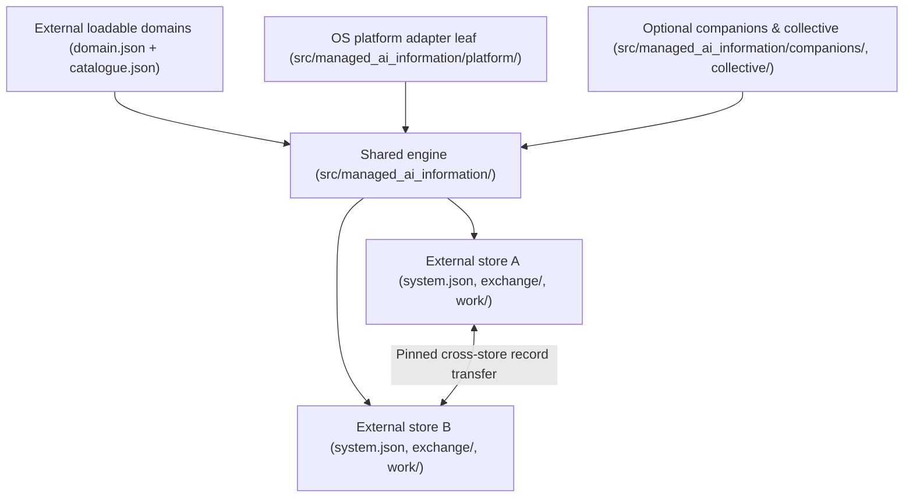

# Architecture

Managed AI Information separates **one shared engine**, **externally loaded domain data**, and **independent stores**. Every subsystem owns its own concrete protocol, configuration, storage, and CLI inside its own package, with a single stdlib-only OS/platform leaf (`src/managed_ai_information/platform/`). A deployment descriptor binds a store to a qualified engine edition without copying engine code or mirroring source corpora.

## Ownership boundaries

| Component | Responsibility |
| --- | --- |
| `src/managed_ai_information/platform/` | Sole OS/platform adapter leaf (`PlatformAdapter`, `LockMode`, Windows `LockFileEx`/POSIX `fcntl`, unfollowed reparse/symlink & Windows reserved-name guards, streaming `sha256_file`, scatter-write `atomic_bytes`, weakref `KeyedLockPool`, and process-group helpers). Stdlib-only and safe for isolated library/recovery-archive reuse. |
| `src/managed_ai_information/deployment/` | Deployment contract and descriptors (`agent-system-deployment/2`), `code_identity()` verification, engine staging/activation, and cross-store owner admission. |
| `src/managed_ai_information/core/` | Content-addressed object store, packet exchange (`exchange/cli.py`, `exchange/open_contact.py`), attention tracking (`attention.py`), return collection (`exchange/transport/collector.py`), layout ownership, and wire-format constants. |
| `src/managed_ai_information/store/` | Native records (`g60-agent-system/0.1`), schema validation, domain/catalogue selection, context capture, `g60-composition/1` views, discovery, graph queries, transfer, governance (`governance/audit_feedback.py`), and turn retirement. |
| `src/managed_ai_information/library/` | Standalone stdlib lexical/BM25/FTS5 knowledge reader, config, search index, catalogue, producer, and product bundles (isolated from `core`/`store`/`deployment`). |
| `src/managed_ai_information/host/` | Concrete continuing-work, material-retention, and signal-field observation services built on top of native stores, each owning its own contract, config, storage, and CLI. |
| `src/managed_ai_information/companions/` | Optional adapters: `workbench/` (model/tool callbacks & durable resume), `peer/` (bounded worker harness), `publication_review/` (dependency observation), and `representation/` (structural checks). |
| `src/managed_ai_information/collective/` | Optional SQLite-backed multi-owner receiving authority. |
| `scripts/` | Repo-local maintainer and CI/CD tooling (never bundled into wheels): `scripts/release/{package,check_current,refresh_guidance}.py`, `scripts/ci/{image_lifecycle,validate_deploy,semantic_profile}.py`, `scripts/release/{current_sources,navigation}.json`, and `scripts/publish_library.py`. |
| External domains | Separate repositories owning domain schemas, source catalogues, entry guidance, and declared tools (`source_root: "."`). Loading a domain never executes its tools. |
| External stores | Caller-owned directories (`system.json`, `exchange/`, `work/`) outside the engine checkout holding goals, records, packets, and local receiving accounts. |

## Storage, schemas, and retention

- **Store descriptor (`system.json`):** Declares stable `instance_id`, `store_schema` (`managed-ai-store/1`), `engine_api` (`managed-ai-runtime/1`), retention policy (`current-use` default or opt-in `append-history`), and SHA-256-pinned domain and instance catalogue bindings.
- **Record envelope:** Every record carries `id`, `kind`, `content`, `relations`, workspace-relative `basis`, `active` metadata, monotonic `revision`, and canonical `sha256`. Typed kinds are validated against loaded domain JSON schemas on write.
- **Source ownership:** Each canonical source body has one owner. Catalogues bind identity, path, bytes, SHA-256, and exposure (`available` or `sealed`). Sealed entries expose metadata only and are never opened as ordinary sources. Availability, acquisition, receiving, and effective use remain distinct claims.
- **Deployment qualification:** `deployment.json` pins `engine.code_sha256` (and optional `git_commit` provenance) alongside the store's `instance_id`, `engine_api`, and `store_schema`. Code changes require explicit `stage` and `activate` before normal execution.
- **Zero-copy HeadIndex v3 & packed object slabs:** Stores maintain an optional HMAC-verified read-only `mmap` index (`exchange/index/head-index.current.json` -> `head-index.gen<N>.bin` with forward/reverse CSR edges, columnar kind/active maps, and an append-only `.delta.jsonl` sidecar) accelerating `status`, `graph`, and `discover` while verifying filesystem freshness and candidate SHA-256 digests. Immutable content objects (`exchange/objects/`) and cold-archived record blobs (`exchange/cold-records/`) support hybrid loose + reserved append-only shard slabs (`packs/CURRENT.json` -> immutable `.slab`, 256-fanout `.idx`, and `.occ` occupancy files) maintained via explicit plan-guarded `pack-objects` and `gc-objects` commands (`>30%` dead bytes trigger physical shard repacking).

## Guarded context, recomposition, and transfer

- **Context / receive / adopt:** `system context` captures governing goals, obligations, selected records, techniques, and workspace basis into an immutable turn packet. `system receive` records an attributed participant return and proposals. `system adopt` rechecks captured basis digests and expected revisions before applying a target write.
- **Authored compositions (`g60-composition/1`):** Records may carry `elements`, `relations`, `premises`, and `opportunities` inspected via `system compose` (with optional `--focus`, `--interaction-map`, and `--changed-since`).
- **Guarded recomposition (`system recompose`):** Evaluates a `g60-recomposition/1` proposal against a pinned target revision and nominated source pins, computing affected consumers and read sets before `--accept DIGEST` or `--retain DIGEST` commits under expected-revision guards.
- **Cross-store transfer (`export` / `receive`):** Exports a pinned observation (`instance_id`, `id`, `revision`, `sha256`). Receiving records the provenance and local receiving account without mutating the source store or silently adopting its claims or duties.

See [docs/engine/INSTANCES.md](docs/engine/INSTANCES.md), [docs/engine/store/README.md](docs/engine/store/README.md), and [docs/engine/CLI-FIELD-REFERENCE.md](docs/engine/CLI-FIELD-REFERENCE.md) for full schemas and CLI specifications.
