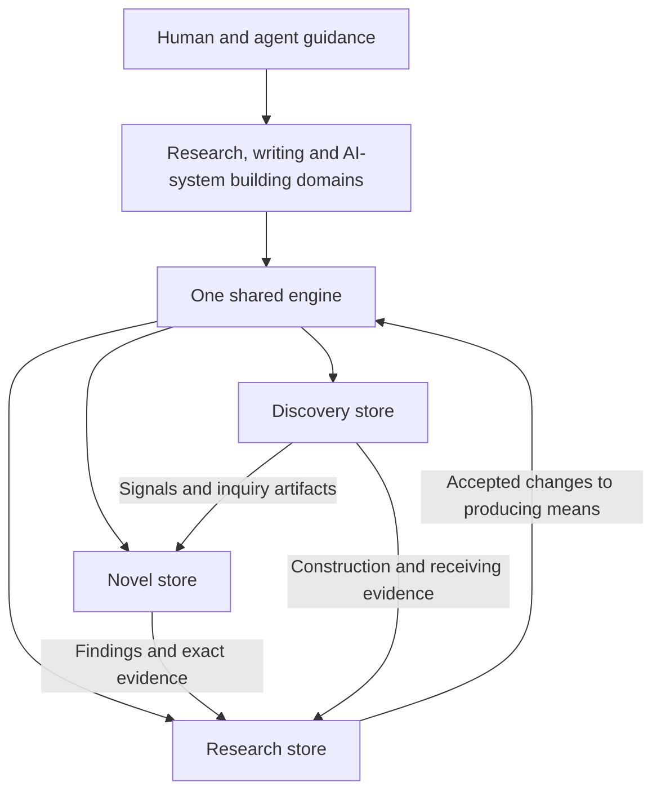

# Shared engine, selected domains, separate stores

The engine implements the common operations. A deployment selects an engine and a store. The store selects domain data, source catalogues and record schemas. Work in one store can receive evidence from another without making a copy of that store or its engine.

## Code and data ownership

| Owner | Responsibility |
| --- | --- |
| `engine/` | Native records, goals, source selection, context construction, receiving, feedback, guarded publication, storage compatibility and deployment. |
| `engine/companion/` and `engine/host/` | Shared optional representation, material-maintenance, peer and continuing-work adapters. These use the common engine and their declared interfaces. |
| `domains/research/` | Complete general theory, research method, reusable patterns, meaningful positive and adverse evidence, and research record schemas. |
| `domains/writing/` | Writing sources, qualified corrections, reusable operations and tools. It does not own a particular novel's acquisition or fulfillment claims. |
| `domains/ai-system-building/` | Guidance and declared tools for understanding, constructing, inspecting and repairing AI systems. The actual current implementation remains in `engine/`. |
| `guidance/humans/` and `guidance/agents/` | Current audience-specific teaching and operating guidance. These are selectable sources, not abandoned publication snapshots. |
| `stores/research/` | Current research claims, gaps, directions, objectives, source-qualified findings, receiving accounts and the two original-history duties. |
| `stores/novel/` | Current manuscript, models, receiving, source-use account and the three duties from the continuing novel commission. |
| `stores/discovery/` | Source-qualified signal candidates, cross-domain inquiry, actual system-construction artifacts and their receiving evidence. |
| `deployments/` | Small engine/store selection descriptors. They contain no copied engines or project editions. |

A source body has one maintained owner. A catalogue supplies identity, location and scope; it is not another authored copy. A generated view may repeat material for use, but its source and regeneration route must be explicit. Claims and duties do not gain another independent owner merely because a second store displays or receives them.

## What the schemas govern

The storage descriptor identifies the instance, storage schema and engine API, and pins selected domain/catalogue manifests. A domain declares its identity, compatibility, source catalogue, entry guidance, explicit tools and payload schemas. Registering a tool describes it; loading domain data does not execute it.

Native records keep the common envelope: an identity, a kind, content, relations, basis and activity state. Revisions and digests belong to the record owner. Explicitly typed content is validated by the schema selected for its kind inside the actual record write path. Generic information remains extensible; the schema does not classify all possible meaning in advance.

The structural schema vocabulary is the bounded vocabulary implemented by this engine. Unsupported declarations require an explicit change or migration. Compatibility and exact source identity are engineering conditions. They do not prove that a schema captures the right distinctions for an unfamiliar task.

New stores use portable workspace bindings. Deployment descriptors resolve the same common engine while selecting different stable instance identities and storage locations. A changed code identity requires explicit qualification and selection before ordinary deployment execution. An engine or schema change must not silently reinterpret already stored data.

## What is loaded

The research store exposes the maintained claim families, gaps, direction conclusions, frontier entry conditions and current findings. Its sources include the complete useful arguments and human/agent guidance, not only abstracts. The novel store exposes its current manuscript, models, receiving, attributed source account and native `novel-artifact-composition`. Its selected writing domain keeps all 110 qualified capsules and the complete source owners available for adaptive discovery.

The discovery store selects the same three domains and registers its artifacts through one instance catalogue. All three stores can select those exact source bodies by reference; exported records retain source ownership and receiving observations have their own owners. The current shared deployment has no automatically populated accepted-project inventory. Arbitrary workspace files are directly selectable, but native discovery needs a record or selected catalogue route.

Availability is not acquisition. The current [source account](stores/novel/work/source-account.json) owns acquisition coverage, actor-specific complete-body declarations, qualified root reception and original-scope reuse. Its `signal-field-novel-stress-current-use` occurrence covers all 110 logical identities through declared current and retained historical witnesses; importing a catalogue row or another participant's account supplies no additional acquisition credit. Observation coverage and actual effects have separate owners in the current signal field and receiving records. A source's article or technical-book origin also does not make every prescription automatically applicable to fiction. Interpret the source for the actual construction and record the affected use.

The earlier complete-field construction is also retained: 110 source identities connect to 155 distinct scoped use rows through 157 declared incidences. Those inherited meanings, model uses and receiving limits have exact account owners. They are not replaced by the narrower complete-capsule acquisition count. Nor does importing them establish fresh whole-novel effects. The current graph exposes both the received and unresolved relationships; an actual next construction qualifies what it uses.

## Artifact composition and selective current use

The shared engine already owns the optional `g60-composition/1` profile and its relation, premise and interaction views. The writing domain's [artifact-composition operation](domains/writing/operations/ARTIFACT-COMPOSITION.md) projects authored relationships, exact chapter units and attributed source-use pointers into that profile. The novel's native graph owns its current state. The domain does not introduce a second graph engine or teach the core about particular characters, chapters or writing criteria.

A guarded focused selection carries its exact parent identity, selected relations, complete useful chapter/account units and selected source bodies. It checks the parent and evidence before native preparation and adoption without expanding every ancestor into the participant's context. An unchanged chapter can need renewed receiving when an earlier chapter or the question changes. Exact byte currency and current meaning remain different judgments.

The graph is selected useful coverage, not an exhaustive semantic model. Structural chapter membership/order, inherited source attribution and authored story relationships have distinct roles. Missing edges do not certify independence. The research domain's [composition observation](domains/research/operations/COMPOSITION-OBSERVATION.md) measures declared incidence and preserves separately authored joint conditions; co-filing sources is not a measurement of causal dependence or literary quality.

The latest [reader-encounter model](stores/novel/work/models/reader-encounter.json) uses the existing event/attention distinction for an actual paragraph-relocation comparison and qualified bookend receiving. The alternative remains viable, current prose is retained, and the bookend relation constrains later compression rather than selecting between those placements. Actual rejoin narrowed two authored claims; it established no new schema or engine requirement. Direct qualified reading remains an adequate route.

The current stores were loaded from selected maintained material. This is a new current-use arrangement, not a reconstruction of missing original native events. The eight missing world-reference bodies and inherited novel generation history remain missing. Original-duty identity records retain their exact qualifications.

## From a novel finding to a repair

The novel owns a finding and the evidence that supports it. It distinguishes the manuscript edition and receiving scope from an unqualified external criticism. When that finding matters to general research or system construction, it exports a pinned record observation. The pin names the source instance, record identity, revision and digest.

Research receives the observation under its own identity, with an account of what was received. Receiving preserves source provenance; it neither accepts the claim nor changes the source's duty status. A later source revision needs renewed receiving or an explicit account of why the earlier captured occurrence remains the relevant evidence.

The receiving participant locates the responsible source of the problem. A literary preference can remain a novel question. A misapplied writing operation can require a domain-tool repair. A source-account error can require attribution repair. A generic deployment or receiving defect can require shared-engine repair. These are judgments from the actual evidence, not an automatic keyword classification.

An accepted repair changes the responsible producing means. Affected work then consumes that change, and receiving checks whether it produces the intended consequence. Where the new observation changes a claim's assumptions, research revises the claim or reopens the appropriate question. It does not require every other research family to restart.

This arrangement supports peer exchange and pairwise reconciliation. The research store is a shared research account, not a mandatory semantic merger for every contribution. A deployment controller selects code and storage; it does not acquire authority to decide all meanings.

## Current work and retention

Maintain the current material, source meaning, useful adverse witness and exact evidence still required by a live use or obligation. A complete previous store, archive, transcript or projection is not retained merely because it once existed. A qualified original source can remain useful even when old publication wrappers and action plans are removed.

Keep duties with one authoritative owner. Research owns the two original-history duties and receives the novel's three commission duties through qualified references. The current research view can expose all five without creating independently mutable status copies. Closing an obligation requires its ordinary owner and receiving account; archive cleanup never closes it.

The research method remains hypothesis, forward implications, gap construction, encounter/proof and reopened hypothesis. Interim material must actually shape production. Use the source field through adaptive discovery and overlap; do not turn 110 available dimensions into one prompt or fixed numerical batches.

## Discovery develops its own means

The running discovery deployment has used the existing native composition profile to represent expected contributions, current evidence, serious alternatives and unavailable observations. Its source field is selectively registered; discovered candidates are then acquired and judged for an actual use. This keeps a missing retrieval route separate from a missing relationship or a missing human observation.

A later system task consumes the first exact system proposal, actual creative/frontier returns and repaired guidance. A separate novel receiver consumes the exported finding and writing guide. Their [research synthesis](stores/research/work/findings/domain-discovery.md) states what those uses support. The engine computes from supplied meanings; neither a dense graph nor an accepted packet proves semantic completeness. Purpose-relative readiness can be reached while optional empirical inquiries and original duties remain open.
