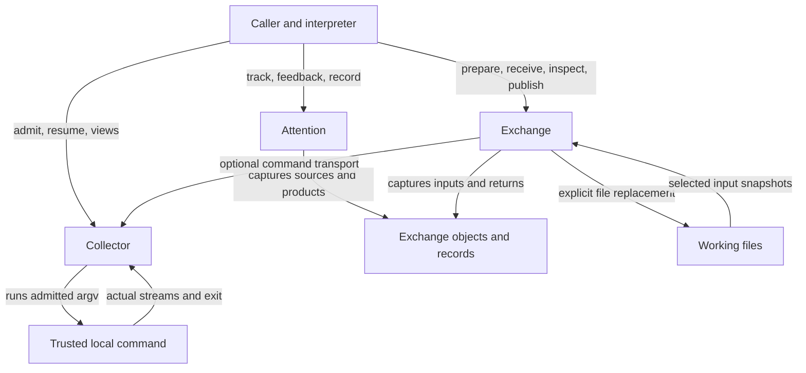
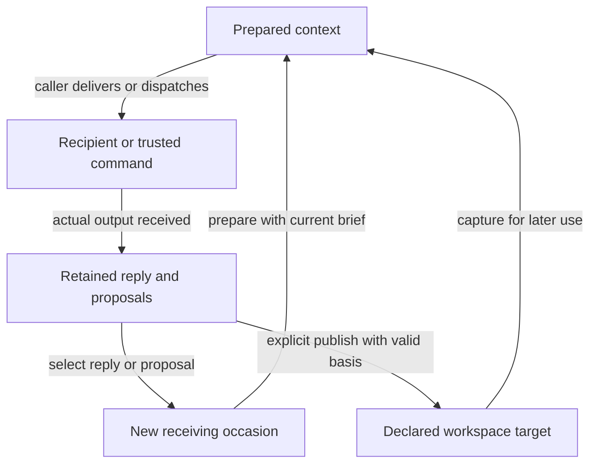

# How the local components fit

Continuation support keeps selected material available to a continuing activity. The caller chooses the contribution, supplies an interpreter or trusted command, reads the actual return and decides its next use. The package preserves the corresponding local records and performs the explicitly requested file effects.

## Three optional relationships

The arrows below show calls and data relationships. They are not a required execution order.

**Attention** helps a caller retain nominated questions, receiving uses and a wider field. Its feedback reports the public record over the selected scope. The interpreter supplies the meaning, useful comparison and next choice.

**Exchange** captures a brief, selected methods and material, then retains an actual reply and any proposed file bodies. The caller can give the prepared context to a person or model through an existing interface and import its actual return. A trusted command adapter is another available transport.

**Collector** runs admitted local commands and exposes their actual result or uncertainty. The exchange's command adapter already uses it. A caller needing only a command return can use the collector directly.

Attention shares the exchange's object storage and owner lock; it does not require a model packet for each question. An exchange packet can use attention feedback as ordinary selected material. Ordinary model-and-files work remains available when these records add no needed contribution. Exact interfaces are in [API](api.md), [attention](attention.md), [exchange](exchange.md) and [collector](contract.md).

## A return has more than one possible next use

The retained reply and proposal can enter another occasion before publication. The new occasion has its own brief, consumer, source selection and permitted targets. A useful proposal can therefore be explained, compared or revised without first changing the workspace file it originally proposed to replace.

When the later interpretation needs the producing instructions, `work.py context
PACKET` recovers the validated original view. Select it explicitly alongside the
reply or proposal. A reply alone may suffice for another use; retaining the larger
view does not require delivering it every time. [Receiving-view choices](exchange.md#choose-the-receiving-view).

Publication is a separate operation. It checks the declared basis and replaces one declared target. A successful publication makes those bytes available to later work; the caller still has to deliver them to the operation that needs them. If the target is a method, a later packet must actually capture and use that revised method for the change to participate.

The same distinction governs failure recovery. A retained return can remain useful when publication was refused because the current basis changed. An interrupted publication can instead leave an uncertain effect that requires inspection. Neither condition authorizes replaying a command or write. The [exchange contract](exchange.md#inspect-an-uncertain-publication) supplies the precise inspection behavior.

## Read the runnable example as a complete local passage

The [quickstart](quickstart.md) follows a declared example sentence into a caller-authored note. It prepares the selected context, receives the note's actual file body, explicitly publishes it, and records a public account tied to that product. A second packet selects the earlier producing context, reply and exact proposal body for a use that needs their relationship.

That final packet is prepared, not answered: the example does not fabricate a reviewer response. The caller-authored files make the storage, receipt and publication operations reproducible without credentials. Actual model work uses the same exchange with the real recipient's output and accurate attribution.

The broad connection is concrete: source material becomes a contribution, that contribution can enter a new use, and an explicit effect can make it part of the working environment. Which contribution is useful, which source relationships are missing, and whether the next producer should change remain interpretive work.

## What the surrounding activity keeps current

| Relationship | Retained or performed here | Caller responsibility |
|---|---|---|
| Current work | Brief, selected method and source snapshots for each packet | Keep the current duty, authority and useful alternatives available across sessions |
| Consideration | Nominated items, scoped feedback, public accounts and captured products | Decide what matters, read the relevant bodies and assess the resulting contribution |
| Actual reception | Prepared context and attributable received output | Deliver context to the intended recipient and carry its return into later work |
| Command execution | Admission, an attempt, collected streams and exit or visible uncertainty | Select a trusted finite command and reconcile an uncertain attempt |
| Changed artifact | Guarded, explicitly requested single-file publication | Supply effect authority, semantic acceptance and any broader transaction |
| Later reuse | Access to intact recorded bodies and their originating occasion | Select an adequate current use and retain the objects it depends on |

An existing application can provide the continuing host through caller-brokered returns, a configured command adapter or direct calls. The [API](api.md#common-boundary) owns the common embedding boundary; each component contract owns its exact effects and limits.
