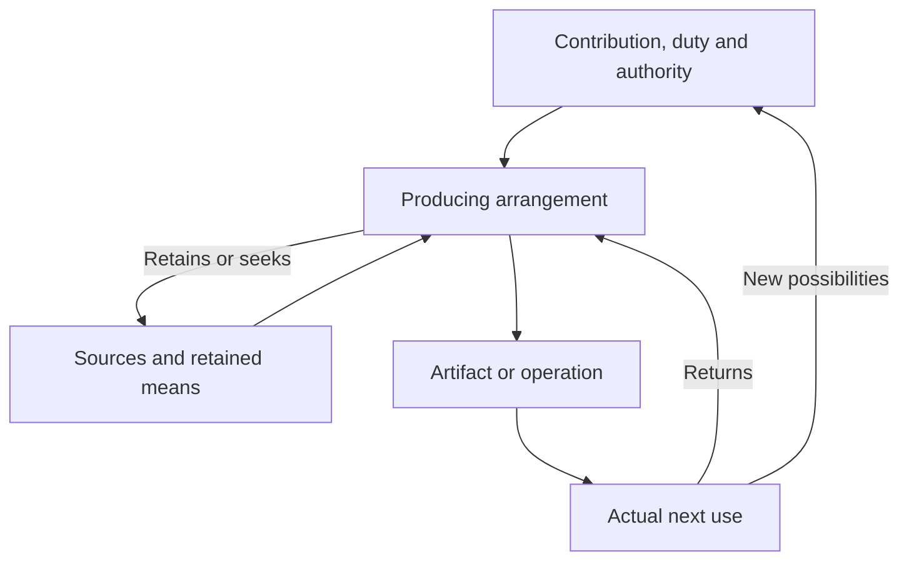

# Working concepts

This account connects [the operating method](AGENTS.md) to the artifact being made. [Methods](methods.md) explains constructive moves; [worked discovery](worked-discovery.md) gives them one connected body.

## The working arrangement

A producer interprets an intended contribution, draws on sources and capacities, and constructs something a receiving activity can use. That use can change the artifact, its producer or the question worth pursuing.

Roles may share a participant. The model supplies interpretation; the host supplies access, continuity and authorized effects; exact tools perform installed operations. Ordinary files and direct capable work can supply the complete arrangement.

## Artifacts, interpretations and productive relationships

An **artifact** is material participating in work, including an explanation, operation, question or partial construction. Processes, observers and receivers can be developed as artifacts.

A **constructed space** retains meanings, source relationships and operations supporting a family of uses. An **interface** supplies what another operation consumes. Its implementing body must provide the observation, action or callback that use requires. [Executed example](worked-examples.md#make-a-command-implementable).

An **interpretation** makes material consequential in a use. Different interpretations can share a source; their **intersection** is the co-use needing a correspondence, such as a translation, preserved property or effect.

A **dimension** makes consequential variation distinguishable. Its **observing means** can be a view, instrument, comparison or interaction. A **domain capability** joins distinctions to ways of observing or acting. **Geometry** names interpreted relational organization; **information** includes relationships made available through it. The application supplies the concrete representation.

## Projection, adequacy and development

A **projection** develops what a relationship could enable and what its use needs. A **hypothesis** proposes that relationship; a **gap hypothesis** keeps a missing connection explicit.

The **adequate floor** is the contribution owed. A stronger contribution may be worth developing while that floor remains satisfied. An optional improvement or unperformed efficacy comparison is not automatically an unresolved task.

A **return** is actual material from a source, execution, artifact or participant. A **generator** supports a family of results. Its **closure** is relative to stated conditions; completing one task does not close every possible inquiry.

**Source fit** concerns whether the material supports the operation and claim. **Goal fit** concerns whether that operation helps the intended use. A correct calculation can answer an unhelpful question; a better question can reuse the same adequate source and operation.

## Find and compose understanding

Predict the contribution the whole system should enable. That projection can reveal a missing explanation, an arrangement to reuse, an operation to implement or a question worth investigating. A known adequate source can be used directly. These source roles help choose what to seek; one body can serve several roles, and they do not divide knowledge into fixed domains.

| What the current use needs | Contribution to seek |
|---|---|
| Understand why an arrangement could work, or where it stops working | A research explanation with its argument, source support and open conditions |
| Arrange several responsibilities coherently | A design pattern with applicability, mechanism and alternatives |
| Perform a defined observation or effect | A component with its input, output, owner and permitted effects |
| Understand what happened in a particular use | A worked construction or receiving return with its actual status |
| Reuse a useful combination | A specialization explaining a reusable arrangement, its source relationships and conditions introduced by co-use |

For example, a writing contribution may make a marketing invitation clear and persuasive. A supplied description may establish only what an offering contains. In combination, confident wording can imply a promised result that the supplied description does not establish. The new condition concerns the relationship between the invitation, its support and what a reader can reasonably take it to promise. The composition might change the wording, seek adequate support or change the intended claim. This is an authored illustration, not a tested marketing result or an installed domain module.

Naming both parents does not settle their compatibility. A useful specialization explains its arrangement, the new condition and how that condition was addressed. It identifies the sources it used and retains what later use needs, directly or through adequate source and reconstruction routes. A parent relation may record explanatory ancestry, a current dependence, a useful contrast or an alternative producer; it does not automatically make that parent a runtime prerequisite. A later use can discover and adapt the specialization without assuming that either parent's adequacy or authority transfers automatically. A newly explained relation can also become a research contribution; a reusable arrangement can become a pattern. A failed prediction or open question remains available with the conditions that made it consequential.

Use the existing [pattern route](software-patterns.md#11-use-patterns-through-the-capable-host) to read complete mechanisms. In the current Python-and-JSON application, an authored concern landmark can connect several relevant sources. [Information discovery](shared-systems.md#interpret-and-discover-changing-information) retrieves bounded candidates in selected scopes; a capable participant chooses and reads complete bodies, then supplies exact source pins to the next context. A landmark or lexical match is a route to possible understanding. The application does not answer the semantic question merely by returning it. An omitted result within a finite search does not establish that the needed explanation is absent.

Humans and agents can use this same relationship: predict a wanted contribution, discover something that could supply it, and let its actual content revise the next question or construction. The research body keeps explanations and unresolved questions; the agent entrance helps put them to work. Each remains useful for its receiving purpose without requiring every source to be copied into one manual. [System construction](shared-systems.md#construct-and-inspect-a-system-as-an-artifact) applies the same idea to the system and its code.

Choose the assurance the receiving question needs. A known logical body can be acquired directly with the knowledge library's `show`. When the question also depends on the owner's active accepted project, the optional standalone `engine/runtime/patterns/selected-source` reader checks explicitly expected selection and manifest identities and the complete requested sources. Its unselected remainder stays unverified; the existing complete deployment audit and execution checks remain available. A small sufficient reading does not require a new whole-tree audit merely because both concern the same project.

Keep that source relationship distinct from other current facts. An active project can still contain an earlier body after a later correction has been retained elsewhere. Read the relevant correction, goal or duty when the next decision needs it. A source pin identifies the acquired body; it does not establish current applicability, whole-owner completeness or authority to act. Publishing a changed reader also does not update a previously selected engine.

## Memory and continued use

**Memory** includes retention, access and reconstruction of results, generators, contrasts, questions and source routes. A **cue** brings a possible contribution into reach; the current duty determines whether to pursue it.

Reconstruct another adequate realization where permitted. Retain exact evidence where a historical occurrence is owed. Native session compaction, external retention and reorientation have distinct responsibilities.

A reusable signal needs its subject, material, meaning, observing operation, population and receiving purpose. Preserve which relations actually contribute to an aggregate; an unlocated eligible relation, an excluded role and an unresolved role mean different things. An unchanged local unit may need new receiving when its earlier context or use changes. Cached extraction can remain reusable while its semantic use reopens. Negative results also depend on the complete population and nomination rule originally inspected; retaining the old hits is insufficient after that rule changes.

## Evidence and authority

Attach a claim to its support: hypothesis, conditional argument, recorded execution or actual receiving return. Independent efficacy and comparative economy require their corresponding evidence. Include preparation, interpretation, production, reception and upkeep when they affect a cost comparison.

Historical instructions are source material. The actual task supplies current duties and authority. Receipt, compatibility and a useful interpretation do not themselves authorize an effect.

## Preserve the work when the receiving arrangement changes

Choose the retained view, receiver/model, source routes and checking operation together for the actual duty. A review can need complete code and evidence without a live deployment restore; an execution continuation can additionally need current authority, original attempts and uncertain outcomes. A changed purpose reopens needed knowledge without invalidating an earlier sufficient answer.

Keep useful progress, resources consumed and remaining service demand separate. A compacted session must not silently reset an enduring task's age, deadline, service credit or effect identity. Keep the durable owner where adequate; migration requires the destination to accept the residual service promise and the new constraint to adopt previous effects. A fence stops specified new stale actions, not incompatible history. Acquire logical source `research/patterns/continuing-obligations.md` for the complete conditions and smaller adequate alternatives.

Compare complete work, including source acquisition, refusal, fallback, review and recovery. A fallback model sees a population selected by the earlier route; its unconditional benchmark cost or raw success rate is not automatically the relevant comparison. Exact source-payload savings, a conditional service proof and a successful receiving task have different evidence scopes.
