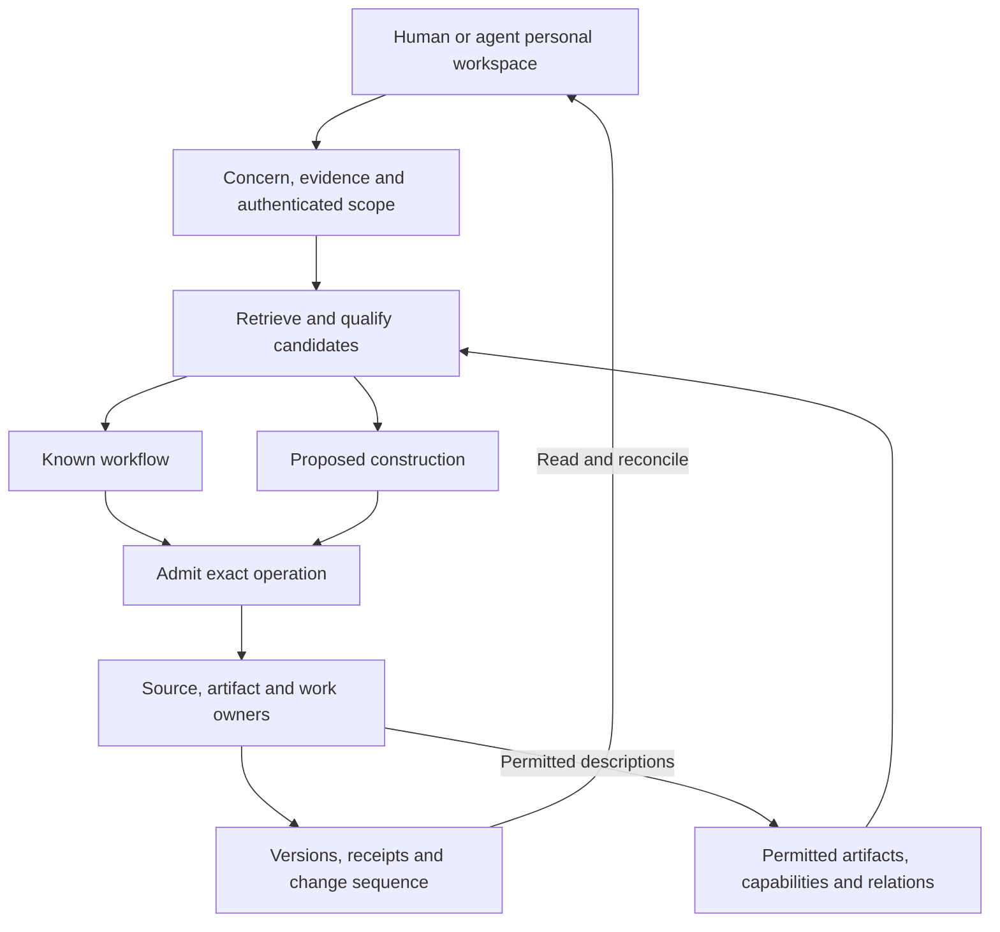
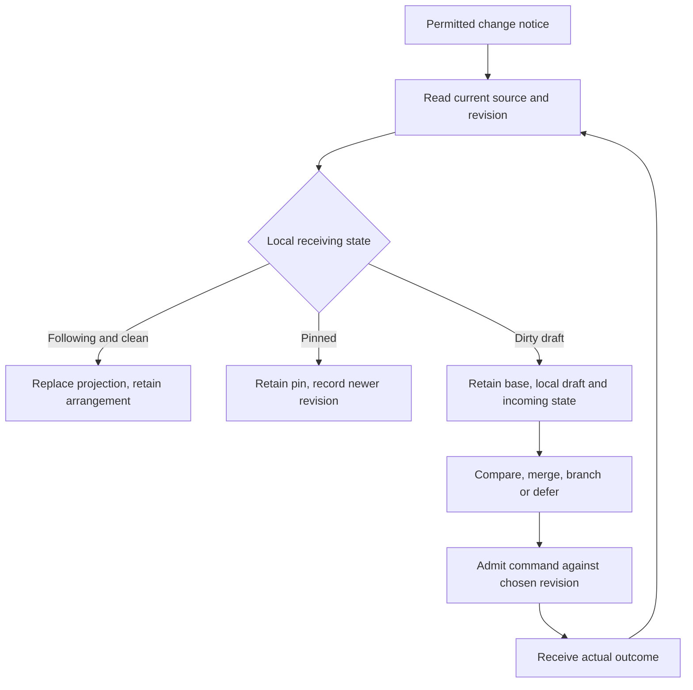

# Compose personal work with shared systems

Use this guide when a human, model host or team needs to construct within a shared AI environment. Identify the contribution, its source and effect owners, the participant's current context and the relationships that must survive change. [Methods](methods.md) develops the constructive operations; [software patterns](software-patterns.md) supplies the smaller state, command, custody and tool mechanisms. This chapter includes the connecting contracts so it remains useful as a detached agent guide.

## Bootstrap a working agent environment

The single shared engine joins persistent goals, selected material, actual returns and explicit artifact ownership around an existing capable agent. Reusable domains supply knowledge and storage schemas; independent stores supply current work. Use the selected research, novel or discovery deployment from the package root:

```bash
python3 -B engine/runtime/select_deployment.py --deployment deployments/research system status
python3 -B engine/runtime/select_deployment.py --deployment deployments/novel system status
python3 -B engine/runtime/select_deployment.py --deployment deployments/discovery system status
```

To create another instance, use the engine's `init` operation with its own instance ID, goal, domain manifests and optional instance source catalogue. Prepared files are data, not an already initialized store. Domains run no tool merely because they are loaded. Serialize commands against one store; separate stores have separate ownership. Trusted commands inherit the host's permissions under the cooperative local contract.

| Needed contribution | Operation |
|---|---|
| Represent or revise a question, process, observer, capability or other artifact | `put --record FILE --expected REVISION`; use an ordinary JSON object with `id`, open `kind` and `content`, plus useful `relations`, workspace-relative `basis` paths and `active` metadata. |
| Prepare actual work | `context TURN --request FILE`; a direct JSON request needs only `task`, `sources` and `targets`. Select further records, technique bodies or previous returns when useful. |
| Retain a real participant's contribution | `receive TURN --reply FILE --producer NAME`, optionally `--proposal TARGET=FILE`. |
| Accept one proposed replacement | `adopt TURN --target TARGET --reason TEXT`; the owner judges its contribution and authorizes the effect. |
| Judge the current whole goal | `interpret --goal-revision REVISION --disposition VALUE --account FILE`, with `VALUE` set to `met`, `continue` or `wait`; `wait` also needs `--condition`. |

`put` checks the expected revision; creation uses zero. Under the selected `current-use` policy, an ordinary replacement advances the revision without automatically retaining every predecessor. Explicit pins, contexts, Information conversions and required feedback retain the exact occurrences they need; `append-history` is a separately selected policy. Recover a particular earlier contribution from its retained occurrence rather than assuming a complete predecessor chain. Relations remain host-authored claims. `context` always exposes complete governing goal, obligation and field records and retains an exact inventory of omissions. Fulfilled/released obligation records remain governing, but their supporting evidence is expanded only when explicitly records-selected or otherwise selected as a source. Still-owed duties retain their normal exposure and admission role. `view TURN` retains the exact original outside-basis bindings; omission does not mean that a source was read, found irrelevant or freshly validated. To recover an old body, use its captured object identity; a current file path can contain changed bytes. The supplied core exposes `engine/runtime/attend.py --root RUNTIME/exchange object HASH --text` for an original object, under the same cooperative owner.

`adopt` checks the captured declared source, record and target basis; an old return can remain useful after its proposed write becomes inapplicable. All governing duty membership/bindings remain part of that contract. Bookkeeping and deployment selection use their owning operations.

The current catalogue composes selected domain and instance sources without copying their bodies. `catalogue ID --text` reads a complete verified source; a context's `techniques` list captures the chosen body. Sealed sources expose metadata only. Availability, exposure, acquisition, interpretation and receiving use remain distinct. Explicitly select a domain tool when its contract serves the task; loading its manifest is not execution.

A trusted finite command can instead supply the return through `run TURN --argv-json FILE`. The argv JSON must pass `{context}` or `{packet}` to the actual adapter. Where the host cannot preserve detached children, add `--wait 20 --producer NAME` to dispatch once and collect in one live invocation. A timeout or missing reply leaves the original occurrence unresolved and does not authorize repeating the effect. Recover or reconcile it through its owning receipt/effect route. Caller-brokered actual replies remain available.

Keep still-owed work explicit. Revise the goal with `put`; a whole-goal account binds its goal revision and separate obligations. Use `--evidence PATH` to bind actual material. Relevant changes require reassessment while unrelated notes do not invalidate all work. Counts and stored dispositions are not semantic proof of fulfillment. Carry an accepted correction into the next actual producer and inspect its real return; a replay alone does not establish useful uptake.

Use acquired Attention when nominated considerations otherwise disappear. `track --spec FILE` retains a question, receiving use, basis and optional groups; a wider-field document keeps concrete alternatives reachable. A context request's optional `attention_groups` and `attention_items` select a union of those scopes; empty selectors retain all-active behavior. `attention_limit` and `attention_max_bytes` bound delivery, while scope selection bounds which Attention source bases are examined. Receive a real account through `assess TURN --receipt FILE --producer NAME` or `receive --assessment FILE`. Record only actual delivered-item treatment. A changed question/use/basis can invite re-entry; a new composition can need a joint-use question. Neither a considered list nor a zero-item view proves whole-goal completion.

## Interpret and discover changing information

Distinguish app release, runtime format, record revision and content interpretation. The open record envelope remains `g60-agent-system/0.1`. The shared engine offers an optional `g60-information/1` content wrapper for a value whose receiver needs an exact definition. Its pin names the complete retained content-contract record body, not merely a current label or a latest-version lookup. A contract can itself be ordinary revisable prose or JSON. Built-in goals and obligations keep their established application shape.

| Needed relationship | App command | What remains supplied by the participant |
|---|---|---|
| Inspect opted-in information and its exact interpretation | `info inspect ID` | Whether that interpretation still serves the current use |
| Assign an explicit definition through the record owner | `info wrap --spec FILE` | The intended value, definition and original-versus-later attribution |
| Accept a specified content migration | `info migrate --spec FILE` | Proposed target content, meaningful preservation policy, change account and unknowns |
| Find sources from a concern or authored anchor | `discover --request FILE` | Relevant concern, scopes, bounds, meaningful relations and applicability judgment |

Use the app guide for the complete spec fields, and inspect the actual current identities before issuing a mutation. Migration rechecks exact source and target-definition bindings and expected revisions, checks nominated pointer-preservation relationships, and preserves the preceding record occurrence. Its input is an explicit reviewed value, not executable instructions found in stored data. These are structural and binding checks. Loaded domain schemas validate their declared payload kinds at the native record owner; they do not supply automatic semantic conversion. A direct edit, changed receiver, read adapter or additional source can be the adequate route instead.

A newly assigned convention must retain that assignment's provenance. For example, a convention introduced now may define `complete` as “source inspection and report complete.” A later definition can separate inspection, implementation and receiving use. The original report does not establish the latter two outcomes. Preserve them as unassessed until actual evidence supports another claim; do not describe the first author's record as if it originally used the later definition. An unavailable fact is not a default observation. Older engines can retain open JSON without supplying the new aware reader's checks.

When a selected opted-in record enters `context`, its exact pinned definition enters too. A later current definition remains a different candidate; it does not rewrite the old meaning. Inspect the complete body where the decision needs it. A source pin establishes identity, not adequacy, and a missing required fact cannot be supplied by changing the wrapper.

Discovery keeps runtime records, accepted project files and historical techniques distinct. Authored references use `record:ID`, `project:PATH` and `technique:ENTRY_ID`. An ordinary record can serve as a landmark through its concern, description and relations; no universal kind or hierarchy is required. Lexical matches and bounded relation traversal provide candidates with source identities, reasons, coverage and suggested existing `records`, `project_sources` or `techniques` context selectors. Read the complete selected bodies before relying on their meaning. Preserve the discovery result as source material when its original query/basis matters. For the context handoff, copy each chosen candidate's exact `{ref, source}` pair into the request's `source_pins` alongside its ordinary selector. The app refuses a changed source identity or a pin whose body was not selected. An intentional change of source needs a current pin and a fresh applicability judgment.

A budget stop or lexical miss does not prove absence. Unresolved endpoints, unread bodies and the remaining search scope belong in the receiving account. A relation such as `may-reuse` remains the author's proposal; it is not silently upgraded to a prerequisite or authority to act. A known direct source path remains sufficient. The general relation and frontier sections below explain how to revise the concern or compare another direction.

Use this arrangement for self-inspection by constructing the connection between a receiving duty, the research relationship and its actual producer. Follow the proposed effect forward and work backward from what its recipient needs. A mismatch can generate a new joint-use question, including one missing from the original design. Select the sources and interpretation needed by that question, repair the responsible producer, and carry the accepted correction into subsequent work. A finite consideration list neither exhausts the research nor makes every technique mandatory.

## Construct and inspect a system as an artifact

Begin with the contribution the proposed system would make for its actual users or agents. Its code, explanations, research, source routes and operating practices can be artifacts within the composition. Project their effects forward and required participation backward. Preserve a serious adequate alternative: an existing operation, direct source, smaller artifact or different producer can remove a supposed prerequisite.

An inspection should compare those relationships with the real implementation and receiving use. For example, a system may preserve every nominated review question while never constructing the question omitted from its initial design. Merely recording a new question supplied by the user does not demonstrate discovery of that question. Trace the intended consequence into the code that supplies it and back from the receiver that needs it. An allowed case excluded by the framing, or a forbidden case admitted by it, can expose the missing or imported condition. The repair may belong to the research or its interpretation as well as to the app.

Treat code deliberately as a proposed composition. Retain what it is intended to contribute, which component owns each consequential relationship, how information reaches the next consumer, and which observation would qualify the claim. Build and review the complete useful body, then let actual failures revise the affected design or producer. No fixed code-dimension list is required. A structural check or source hash can qualify its own contract without establishing the artifact's semantic adequacy.

Tasks can be derived requests for useful contributions or mutations; they need not define every artifact as a task. Review is itself a composition that supplies a current judgment to another decision or producer. A scalar score, separate model role or executable test is an available means when it serves that relationship, not a prerequisite for every contribution. A prediction of another AI system is also an artifact: realize the needed parts, use them for actual work, and carry the returned gaps into the next construction. The prediction alone does not establish an executing or generally aligned successor.

### One useful arrangement for a bounded review

Give the reviewer the actual receiving duty, the target's promised effects, relevant research or contract bodies, and a route to the accepted implementation. Where question development is part of the task, ask for a short public prediction before acquiring implementation: what the recipient should be able to do, which relationships would supply it, and what observation could distinguish a gap from adequate behavior. Retain the original prediction when later evidence changes it. A known defect or adequate operation can be handled directly without this extra occasion.

Acquire the complete bodies needed by the derived question. Known paths can suffice; discovery is available when navigation is unresolved. Distinguish copying or hashing the target from reading it, and identify which promised relationships remain unassessed. Trace the effect through the actual adapters and owners: a downstream guard cannot recover a destination or later personal intent that an earlier producer discarded.

Return the source-qualified finding or adequate result, the responsible producer, concrete evidence, and a complete proposed repair where needed. A focused comparison can apply the same observer to original and proposed producers while retaining useful positive cases. An owner-supplied follow-up remains separately attributed; it is not retroactively part of the reviewer's initial discovery. Useful existing research can remain unchanged when the missing connection belongs to implementation.

Keep sibling contributions available, including source clarification or an adequate no-change account. Different code targets may still share contract or validation pages, so one owner composes the actual effects and serializes runtime calls. Receive and assess the proposals, carry accepted changes into their next receiving use, then judge the current whole duty. Captured context and an authored composition preserve the work's basis; they do not supply the participant's semantic judgment or prove superior review quality.

When reusing Attention, read its actual question, declared use and source basis. A prior account marked considered may remain fully adequate for its old use while a new composition needs another connection. Explicitly reuse that contribution, revise the actual use, or nominate the new joint-use question. Keep the current wider alternatives distinct from a historical field selected as source material. A goal change alone does not make every old treatment invalid, and selecting an old account does not establish its applicability to the new whole.

## Preserve an open field while work proceeds

Keep useful contributions across artifacts and across their relations available when one realization waits. A blocked implementation may still permit source work, an explanatory revision, a review of another connection or a different producer that removes the dependency. Reopen this comparison after a consequential return. A narrow focus does not need to become the only possible next move.

Separate parallel construction from compatible effects. Two proposals with different output paths may still read one another's targets or share a changing source. In this app, every prepared context also captures the governing goal, field and obligations, and publication checks all selected material and targets. Revising the wider field can therefore refuse a still-useful sibling proposal. This conservative check preserves the old return; it does not determine that the proposal is wrong or requires new authorship.

Use the existing retained-artifact route to establish its current use. An illustrative fresh request can select the exact old proposal alongside the material that now matters:

```json
{
  "task": "Assess the retained design under the current field; retain its body if it remains adequate, otherwise propose the necessary revision.",
  "artifacts": ["earlier:outputs/design.md"],
  "sources": ["sources/current-design-basis.md"],
  "targets": ["outputs/design.md"]
}
```

Replace the illustrative turn, source and target with actual existing identities. Prepare this request under a new turn; the old proposal is captured material, not inherited target authority. The actual participant supplies a current applicability account and justified body. Receive and adopt that contribution through the ordinary owner. Identical accepted bytes can be a useful outcome; do not relabel the original occurrence or bypass its failed guard.

A reusable view may expose declared prerequisites, alternatives, open relationships, source observations and read/write interactions. Read its bounds and unresolved references. No detected interaction under an authored footprint is not a guarantee of independent execution, and an empty declared gap list is not complete alignment. Current source and effect owners retain the actual execution contract. Select a useful set of contributions rather than turning every optional possibility into mandatory work.

## Maintain a deployment through accepted revisions

Each deployment is a reference descriptor selecting the shared engine and one independently owned store. It binds engine source identity and instance identity without copying an engine or maintaining per-edition executable trees. Source bodies have one canonical owner in the engine, a domain, shared guidance or current instance material.

Inspect the actual descriptor and store configuration before changing selection. The engine's deployment help owns precise command fields. A source change, schema change or selected engine revision needs its actual receiving account and relevant verification. It does not automatically invalidate every prior useful contribution or settle an unknown effect.

Use store catalogues to select instance sources and domain catalogues for reusable knowledge. Native expected revisions and source pins govern affected publication. For a cross-instance finding, export the actual source record and receive a pinned observation with an explicit local account. The source instance retains authority over its head and duties. A receiver can map the finding to its own theory or open feedback, then change its own producer only when the qualified finding warrants that action.

The initialized stores use portable bindings within the package. Relocation preserves available current bytes and record identities; it does not prove continuity of an external operation. Preserve unresolved effects under their actual owner and occurrence rather than silently retrying them. Keep the next meaningful task selected, retire trace without a current use, and receive actual changed work after a repair.

## Establish the complete responsibility map



Each box is a responsibility that can be a module, an existing host capability or a service. Do not infer a deployment topology from it. Identify the real boundary where another authority, asynchronous process, device or storage system changes the contract.

Keep six objects distinct: personal layout, working draft, published proposal, accepted artifact, transient presence and work obligation. A shared document can hold content while personal records retain arrangement and attention. A model context is one participant's working state; its durable references, responsibilities and pending effects need recoverable owners outside that context where continuation requires them.

The semantic contributor may be a person, model or established procedure. The exact runtime may validate a descriptor, retrieve a known body and execute a registered operation. Describe which participant supplied an interpretation; an installed schema or `fit` field does not establish semantic competence.

## Choose placement without changing the contract silently

| Responsibility | Local, open example | Service, constrained example |
|---|---|---|
| Source owner | User's local repository | Authorized service repository |
| Presentation | Approved components acquired when needed | Already installed client library |
| Routing | Develop concern, inspect means, compose permitted steps | Page/action contract selects an established workflow |
| Effect boundary | Trusted local operation; explicit remote disclosure when required | Service command checks caller, resource and current state |
| Artifact | Local draft or local accepted object; optional publication | Service-owned accepted version and scoped view |
| Continuing work | Local references and subscriptions where relevant | Personal view plus shared change/recovery protocol |

These are two illustrative combinations. A service can support open composition, and a local tool can be fixed. Distinguish selecting a known operation, demand-loading an approved implementation and admitting a newly developed executable. The last requires an actual body, a reviewed use contract and an execution boundary appropriate to its trust; the [capability example](worked-examples.md#add-a-capability-and-receive-its-use) supplies a concrete case. Keep integration credentials inside the broker. Remote semantic processing discloses its input even when the original source remains locally stored.

The [local-first account](https://www.inkandswitch.com/essay/local-first/) supplies a known family of local ownership and collaborative designs. Its existence does not determine this task's replication unit or access policy. Choose those from the actual artifacts and participants.

## Route according to what remains unsettled

Receive a context with references and revisions, an original request, the current interpreted concern, and available capability descriptions. Derive identity and authority from a trusted host boundary. Keep source input and later interpretation separate.

Direct dispatch is appropriate when task meaning and applicability are established, required inputs are available, and the operation is authorized. The page contract and a deliberate user action can supply that meaning. A model need not reconstruct a workflow for every click.

One visible candidate alone is insufficient. It may be the only retrieved item, the only permitted description or an unsuitable survivor of filtering. Several candidates can require comparison; zero candidates can require examining coverage, changing anchors, acquiring an input or constructing a missing capability. Discovery is selected by the missing relationship, not forced by a particular product label.

An inspectable candidate response should identify:

```text
context and catalogue revisions
candidate identity and version
retrieval anchors, public source basis and fit explanation
required inputs, effect description and material unknowns
search scope, coverage limits and unexamined remainder
next available operations
```

Bind a selected option to its response revision. A changed context requires revalidation, not silently applying the old selection to a new meaning. An inferred intention remains revisable. A proposed composition reaches the same admission boundary as a known operation.

## Give both humans and agents a way to challenge the frontier

The frontier is a current view of useful possibilities, not necessarily a stored hierarchy. When exploration is wanted but no concern exists, offer grounded starting points and identify their basis. When a concern exists, develop directions with consequences and uncertainty. Let the participant inspect sources, ask why, compare alternatives, reframe, go elsewhere, select directly or stop. A completed duty can leave no selected continuation; generating more candidates is not an outstanding obligation.

Human controls can be cards, lists and detail views. Agent tools can expose corresponding `read`, `explain`, `inspect`, `select`, `reframe` and `dismiss` operations. The same public contract can support different presentation density and permissions. Explain using retained facts and declared interpretation; do not invent access to a ranker's hidden reasoning.

Preserve a wider comparison at meaningful boundaries. Consider the immediate child, a shared producer or bottleneck, and a concrete alternative source or arrangement. The broadest contribution need not have the highest graph degree or the longest description. The [operating method](AGENTS.md) governs this re-selection; [attention](attention.md) can retain nominated considerations without making its mechanical ordering a semantic priority rule.

The [Human–AI interaction guidelines](https://www.microsoft.com/en-us/research/wp-content/uploads/2019/01/Guidelines-for-Human-AI-Interaction-camera-ready.pdf) support correction, dismissal and understandable behavior. Here those become receiving operations, not a compulsory approval prompt for every already authorized action.

## Find work through relations and preserve their meaning

A predicted contribution can nominate anchors: an artifact identity, source, intended effect, constraint, participant, example or phrase. An artifact type is one possible anchor. Retrieve through exact references, indexed text, explicit relations and optional similarity; then inspect enough relevant bodies to decide applicability.

Retain the distinction between `requires`, `uses-source`, `may-reuse`, `conflicts-with` and `similar-to`. These are illustrative roles rather than a mandatory relation vocabulary. A model-proposed edge needs attribution, basis, status and relevant versions. A similarity result cannot silently become a blocking dependency.

Use bounded traversal with cycle handling and item/time/byte limits. Budget exhaustion leaves partial coverage. Authorize names, counts, relation endpoints and explanation text before disclosure. A retrieval score is not a permission check, calibrated confidence or guarantee of complete recall. [Faceted search](https://searchuserinterfaces.com/book/sui_ch8_navigation_and_search.html) and [SKOS association schemes](https://www.w3.org/TR/skos-primer/) are established optional navigation mechanisms.

If the available observations cannot distinguish candidates for the current use, acquire a meaningful distinction or treat equivalent options as interchangeable. An arbitrary identifier can break a tie operationally but supplies no evidence of superior fit. No source route means acquisition is needed; predicting the route does not make it exist.

## Keep personal state compatible with shared changes

For each referenced artifact, retain its identity, following or pinned policy, observed revision, draft base revision and local edit generation. Preserve any local draft separately from the accepted projection. A layout action changes layout; a branch creates a new work identity; a publication changes visibility or accepted content under its own policy.



Do not advance a draft's base merely because a notice arrived. That would assert that the draft incorporated information its author never received. After a save, clear or replace local input only if the returned outcome still corresponds to that input generation. Keep pending effects with their original target and identity beyond view disposal.

Shared editing can stream changes under an established mode; private scratch work need not publish automatically. CRDTs or operational transformation can implement concurrent data operations for appropriate shared types. Convergence does not settle whether the combined artifact fulfills its use. [Automerge conflicts](https://automerge.org/docs/reference/documents/conflicts/) provides a concrete example where conflicting assignments remain available for inspection.

## Receive signals without losing changes or authority

The source owner should retain a change record consistently with the accepted change. A small implementation can expose that durable sequence through polling. A distributed implementation may use a transactional outbox and a sender. The [outbox pattern](https://docs.aws.amazon.com/prescriptive-guidance/latest/cloud-design-patterns/transactional-outbox.html) addresses the state/message dual write and still requires duplicate-safe consumers.

Open a view with a snapshot and cursor from a consistent boundary. Read or subscribe after that cursor. Apply the permitted interval safely before advancing the consumer's durable position, or make replay harmless. Keep stream identity/epoch, scope and filter semantics explicit. An expired history, changed scope or invalid cursor requires a reset and fresh snapshot while preserving local drafts.

SSE or WebSocket is a transport choice. [SSE event IDs](https://html.spec.whatwg.org/dev/server-sent-events.html#the-last-event-id-header) support reconnection positioning; the server must still provide history and authorized replay. A connected socket does not establish freshness. Present lag, offline state or refresh requirements according to actual evidence.

For invalidation, several changes can coalesce into a current read. For a command or obligation, intermediate occurrences may be essential. Decide which contract applies before discarding them. Reverse dependency indexes can identify affected work; they propagate installed relationships rather than discovering every new consequence.

## Claim work against current conditions

A readiness signal means that recorded conditions held at a particular generation. Before claiming work, atomically check current permission, blockers, expected generation and ownership, then retain the reservation. Another participant may have added a blocker since the signal. A later blocker requires a defined response—pause, revalidation, review or an explicitly independent continuation.

Blockers need attributable reasons and resolution rules. A proposed blocker is not automatically an authorized mutation of work readiness. Cycles can be meaningful in inquiry relations; strict prerequisite cycles may require joint work or reinterpretation. Do not impose a DAG on the entire environment to simplify one scheduler.

Search for potentially overlapping work before expensive construction, but separate that search from ownership. Exact uniqueness constraints can protect a known equivalence such as resource/version/operation. Semantic duplicates can still cross differently named tasks. Claims and leases prevent only the races their owner checks; a late worker needs an effect boundary that honors the current claim or fencing generation.

The resulting composition is adequate when participants can reconstruct the relevant context, understand current authority, receive changes, preserve local work and submit outcomes through the correct owner. Review actual source/consumer passages and the whole arrangement. Keep unobserved performance, usability and semantic-discovery claims distinct from the mechanisms that were implemented.
