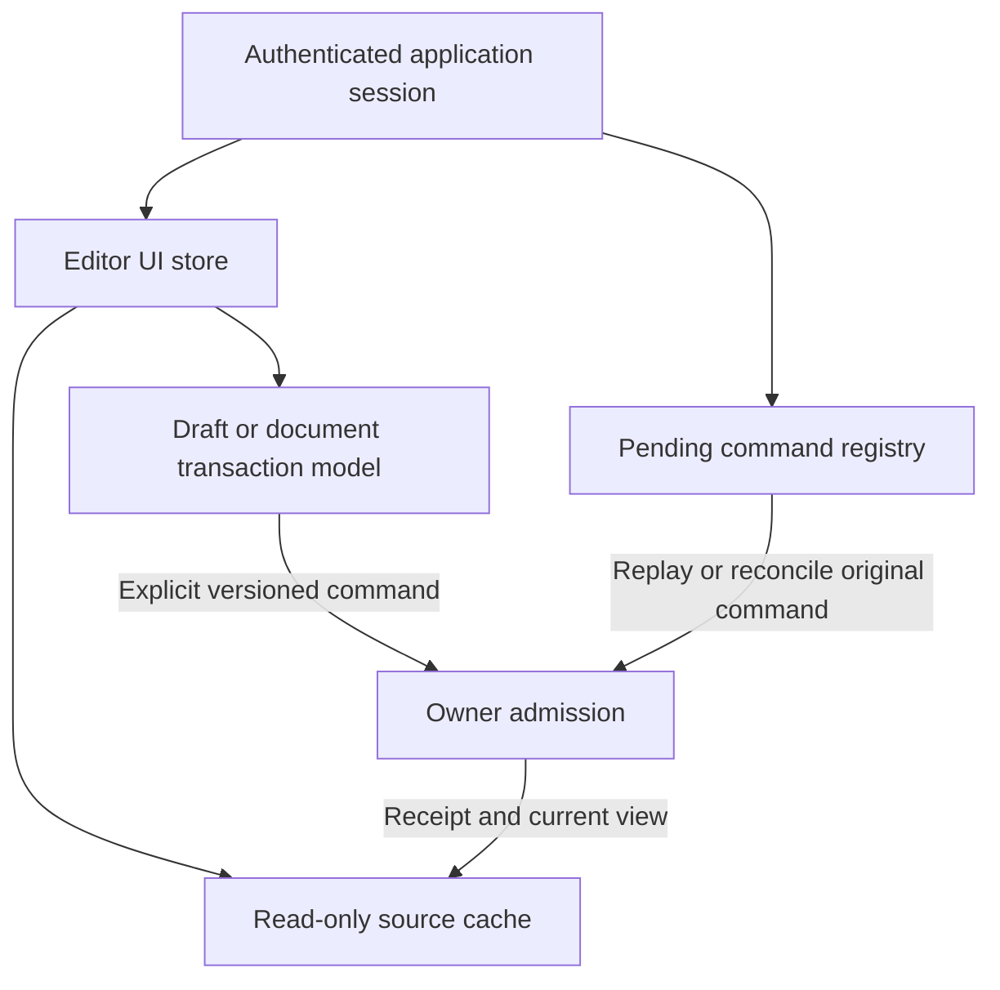
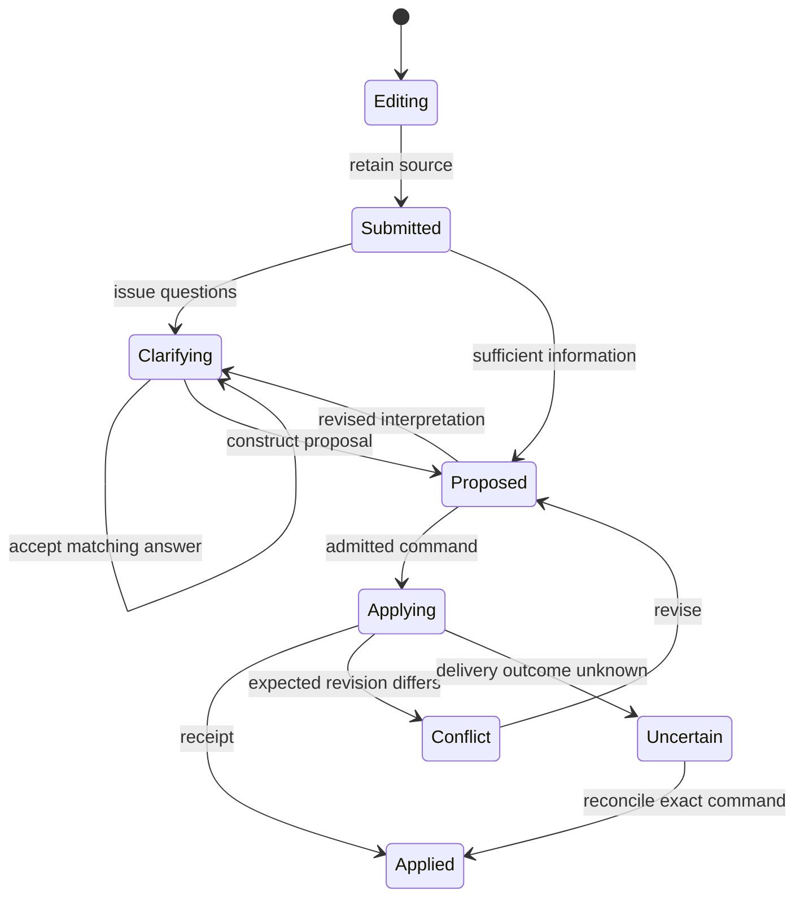
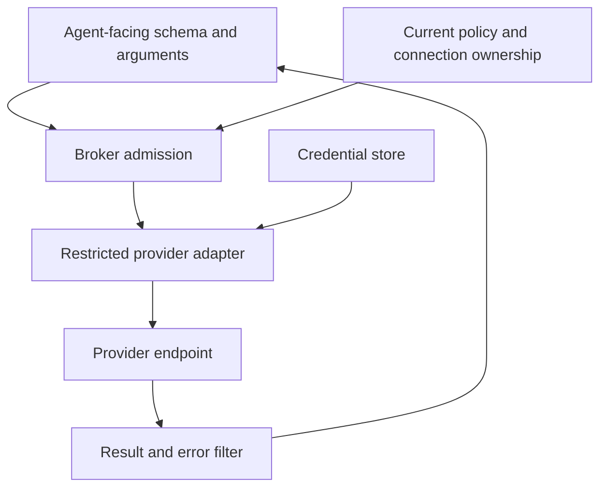
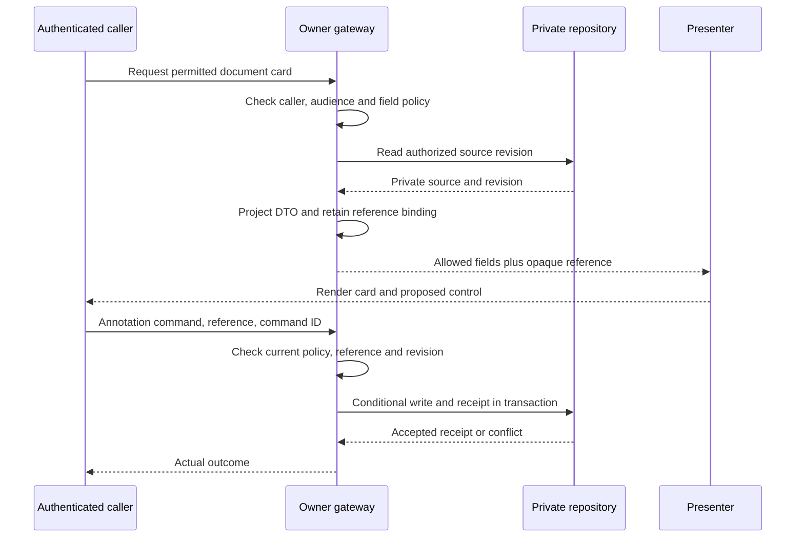

# Construct software from explicit patterns

Use these mechanisms to connect an AI system's intended behavior to state, interfaces, authority and durable effects. Select the pattern that supplies a missing relationship, understand its contract, then compose it with the other selected patterns. A catalogue match, framework choice or complete application example does not settle the architecture. This guide is usable on its own; the optional prototype contains focused demonstrations and an integrated reference.

## 1. Select from constraints before selecting a stack

Record the source/effect owner, authenticated actor, data recipients, lifetime, concurrency and recovery needs. Keep supplied requirements separate from implementation preferences. A local editor, a remote presentation service and an enterprise data repository can participate in the same use without sharing custody or authority.

| Pattern | Choose it when | Contract to carry into implementation |
|---|---|---|
| Scoped presentation model | Components share editor controls | One store instance per actual owner/lifetime; document authority stays explicit |
| Scoped asynchronous state | Reads and results can outlive the view | Subject/access cache key; captured scope and generation; reconciliation for effects |
| Guarded intent protocol | Questions or proposals may change while the user answers | Intent, proposal, question and answer identities/version checks |
| Transient resource lifecycle | Uploads, previews or drafts exist before durable adoption | Owner, handle, expiry/disposal and explicit promotion |
| Approved renderer registry | An agent composes UI descriptors | Schema/version validation and reviewed component resolution |
| Owner-controlled projection | A presenter needs selected information from another owner | Allowlisted envelope, private binding and current authorization on each use |
| Derived-view maintenance | Computation or source changes require a view strategy | Source versions, freshness, invalidation/rebuild and writeback meaning |
| Conditional command and receipt | Effects can conflict or be retried | Exact command identity, payload binding, concurrency condition and atomic receipt |
| Tool/credential broker | Agent-facing operations need private connections | Execution-time admission, restricted adapter, secret custody and result filtering |
| Source evidence and interpretation | Agents reason over user input or external observations | Preserve received source separately from attributed interpretations and decisions |
| Qualified source acquisition | A reader needs particular source bytes and their owner-selection relationship | Explicit expected selection/manifest, complete selected bytes, bounded reads and an unverified remainder; retain full audit separately |
| Versioned tenant artifacts | Discoveries may be shared or adopted | Authorization on reads/writes, explicit version and dependency disclosure |
| Pattern knowledge in use | The current construction lacks a software relationship | Read complete relevant mechanism, revise design, inspect actual return |

These patterns mostly compose established mechanisms. The adaptation is their use around fallible proposals, user evidence, tool discovery and mixed-service ownership. Do not describe the arrangement as a new authorization, synchronization or privacy invention. Prior-art sources below identify what is established; prediction-led selection and downstream implementation improvement remain empirical questions.

## 2. Partition state by owner and lifetime

Do not make a module-level global store the default container for every kind of state. Create a scoped store for editor controls, use the document engine or draft controller as the one writable document model, and treat remote data as a derived query cache. Command recovery may need an application-session owner or durable repository independent of the editor.



A useful logical scope is `{principal, tenant, workspace, document, sessionGeneration}`; include only fields that actually distinguish the subject or access contract of that state. Query keys must cover variables used by the query. Do not put a bearer token or credential in a key. Cache separation is not authorization: derive trusted identity on the receiving side.

Example client structure:

```ts
type EditorScope = { principal: string; tenant: string; document: string };
type EditorState = { scope: EditorScope; selectedId?: string; draftId?: string };
// Create this store for an editor owner; expose the instance with context.
// The document contents belong to their draft/document model.
const documentKey = (s: EditorScope) =>
  ['document-view', s.principal, s.tenant, s.document] as const;
```

Zustand vanilla stores plus context can implement the scoped UI store. React reducer/context can be enough for a smaller surface. TanStack Query can own asynchronous cached reads. A rich document editor should retain its native transaction semantics rather than mirror all writable content into several stores. [React state structure](https://react.dev/learn/choosing-the-state-structure), [Zustand scoped useStore examples](https://github.com/pmndrs/zustand/blob/main/docs/reference/hooks/use-store.md), [TanStack query keys](https://tanstack.com/query/latest/docs/framework/react/guides/query-keys).

Capture scope and generation before starting asynchronous work. Cancel obsolete reads where supported, then still check admission before applying a completion. A cancelled browser request is not a cancelled server mutation. Keep the original command target, expected revision and ID in the recovery owner; never retarget it to whichever document is now visible. For reload recovery, choose durable storage explicitly. An in-memory registry survives a component unmount only while its containing process survives.

## 3. Give transient objects explicit passage

A temporary resource needs a handle, actual owner, kind, lifecycle status and disposal operation. A preview URL is not the file itself. A browser object is not a durable artifact. A draft ID is not an authorization grant. When an editor is replaced, release its owned subscriptions, object URLs and disposable resources; retain independently owned pending commands.

Promotion is a named operation: validate the current temporary handle and caller, bind the bytes or content digest actually received, accept them into the destination and return the new durable identity. A stale callback must not promote a replacement resource that happens to occupy the same UI slot. If the backend accepts uploads before promotion, give those bytes an expiry/garbage-collection policy and a recovery path.

## 4. Bind intent answers to their question

An intent submission preserves the original input. Interpretation produces a proposal with stable identity and a revision. A question carries its own identity and revision. Its answer refers to those identities, not an array position.



```json
{
  "intentId": "intent-7",
  "proposalRevision": 3,
  "questionId": "question-a",
  "questionRevision": 2,
  "answer": "Use the selected document"
}
```

Check that the current proposal still expects this question revision. If it does not, reject or use an explicit migration rule and retain the typed answer for reconsideration. A deterministic reducer is adequate for many interfaces; use a statechart when parallel or hierarchical states justify it. [SCXML](https://www.w3.org/TR/scxml/) supplies established transition/guard semantics; [XState](https://stately.ai/docs/machines) is one optional implementation. The model's proposal quality remains a separate responsibility.

## 5. Preserve source and interpretation separately

At authenticated ingress, preserve the exact received text or bytes under the applicable access/retention policy. Attach an evidence ID, source identity, received time, scope and content binding. Store an interpretation as a separate attributed record referring to the evidence it used. Corrections supersede the interpretation or accepted proposal; they do not silently rewrite the source.

```text
evidence: {id, authenticatedSource, scope, receivedAt, exactText}
interpretation: {id, evidenceIds, producer, proposalRevision, proposedMeaning}
decision: {id, proposalId, proposalRevision, authorizedActor, operation}
```

This supports attribution and comparison. It cannot stop a model from ignoring or misreading evidence. A model does not gain authority because text is labeled evidence; source instructions remain subject to the host's instruction and authorization boundaries. Do not claim an append-only ingress table is a complete event-sourced domain. [W3C PROV](https://www.w3.org/TR/prov-overview/) is an established provenance vocabulary.

For an existing deployment, distinguish the source assurance actually needed. The optional `engine/runtime/patterns/selected-source` reader binds complete requested project bodies to explicitly expected active-selection and manifest identities. It checks those selected bytes and modes while retaining an explicit unverified remainder. The existing full-tree verifier and system execution gate keep their stronger checks. Use the knowledge library's `show` when its logical body and catalogue pin already suffice; a manually checked manifest and selected read are also an adequate direct construction. Acquiring an active-project body does not discover a later correction retained elsewhere, inspect every current owner fact or install a new engine.

Bound the actual read before accepting or rejecting the bytes. A declared size check followed by an unbounded read can consume a much larger changed file before a correct hash refusal. The published discovery providers now check static size, accumulate bounded chunks and permit one excess byte only to detect growth before aborting. Record interpretation and retained raw bytes come from one authoritative acquisition, with the existing validator applied to that same body. Keep source admission, an aborting sentinel byte, metadata work and enclosing deployment verification distinct in the cost account.

## 6. Resolve components and tools through different boundaries

A UI descriptor should declare a schema version, supported component kind, permitted properties and typed controls. Validate the complete descriptor. Resolve it through an allowlisted registry. Unknown versions get a visible fallback or rejection. A control invokes an admitted command; it cannot certify its own effect.

```ts
// The mapping is application-owned, not supplied as an arbitrary URL by a model.
const loaders = { textCard: () => import('./TextCard'), table: () => import('./Table') };
// Validate kind/version/properties before selecting an entry.
```

[React lazy](https://react.dev/reference/react/lazy) supports deferring approved component loading. It does not establish trust or isolation. A runtime package/plugin system needs origin, version, integrity and compatibility rules, with an execution boundary suited to the admitted code. For less-trusted remote UI, define a separate-origin frame and narrow message contract; do not let it inherit host capabilities accidentally. [WHATWG iframe](https://html.spec.whatwg.org/multipage/iframe-embed-object.html#the-iframe-element).

Admitting newly developed executable code additionally requires its body, applicable input contract, permitted effects and review. The [capability example](worked-examples.md#add-a-capability-and-receive-its-use) uses trusted local Python with source and output bindings. It demonstrates reviewed admission into a running host; it does not supply isolation for arbitrary code. A changed recipient question may need only a new invocation and explanation when the admitted operation remains adequate.

Tool discovery returns descriptions and current availability hints. Invocation is separately admitted against current authenticated identity, resource scope, permitted arguments, budgets and connection ownership. A remembered catalogue entry is not a grant.



The broker retrieves credentials privately, validates an allowed destination and operation, invokes the provider, and returns only permitted fields. Do not offer unrestricted URL/header arguments unless that is the deliberately authorized capability. Redact credentials from traces and errors. An internal connection reference is still checked for ownership; it is not a secret-bearing URL. Use the provider's actual OAuth/delegation contract where appropriate. [OAuth security BCP](https://www.rfc-editor.org/rfc/rfc9700.html) and [OAuth token exchange](https://www.rfc-editor.org/rfc/rfc8693.html) are grounding for delegated token handling, not substitutes for application policy.

## 7. Separate source custody, projection and writeback

Start with three placement options: remote presentation definition rendered locally; remote presentation of a permitted projection; or remote transformation of disclosed inputs. Each gives a different party data. User ownership does not require physical local storage, and a service's presentation role does not justify acquiring all originals.



The displayed fields and all transmitted metadata are disclosed to the presenter. Construct the envelope from an allowlist; do not copy a complete domain object and remove only known secret fields. The owner retains private source/version bindings under an unpredictable opaque reference. Bind it to the intended principal, tenant, presenter audience, resource, permitted operations and expiry/revocation conditions. Never treat the reference alone as authorization.

An annotation command may identify `viewRef`, `commandId`, `expectedRevision` and the proposed annotation. The owner authenticates the caller, looks up the reference, checks current grants and allowed action, verifies the source revision, then commits the annotation and receipt atomically. Reject attempts to change fields outside the operation. The actual implementation must handle concurrent callers, not merely sequential happy paths.

An allowed envelope can be:

```json
{
  "schema": "document-card/1",
  "title": "Selected document",
  "annotation": "Review this section",
  "viewRef": "opaque-owner-issued-reference"
}
```

Private body text, private notes and credentials are absent. The reference's lookup table stays with the owner. A structured token such as a normal JWT is not confidential merely because it is signed. A low-entropy content hash can also reveal or correlate information; use a reference appropriate to the threat model instead of sending an internal content-bearing serialization.

The known mechanisms are [DTO](https://martinfowler.com/eaaCatalog/dataTransferObject.html), explicit projection, current authorization, and optimistic concurrency. [OWASP object-property authorization](https://owasp.org/API-Security/editions/2023/en/0xa3-broken-object-property-level-authorization/) motivates checking returned fields. The architecture can fit an in-process owner, a personal data service or an enterprise gateway. It does not establish remote privacy for already disclosed fields.

## 8. Choose view maintenance independently of serialization

Serialization is encoding; transformation is computation; materialization is retained output; synchronization is the mechanism relating updates. Specify each separately.

| Strategy | What to implement | Cost or failure to consider |
|---|---|---|
| Compute per read | Authorized source snapshot, transform version and result | Repeated cost; source consistency during read |
| Cache/materialize | Retained result, source/version key, refresh/invalidation route | Stale results and permission changes |
| Incremental update | Ordered/checkpointed changes, deduplication and rebuild | Missing/duplicate events, partial views and projector changes |
| Historical snapshot | Explicit result identity and source/version provenance | It remains historical after the source changes |

A simple query and conditional command may use one database and one process. Read/write model separation does not require event sourcing or separate services. [Fowler's CQRS account](https://martinfowler.com/bliki/CQRS.html) explains why to apply the additional separation selectively.

Define writeback meaning. An editable view field must map to a named source operation or a supplied, validated bidirectional update relation. A generic inverse of a summary does not exist just because the summary is rendered. If the read model is stale, the command still checks the authoritative current revision and policy.

## 9. Make command outcomes and retries precise

An effect command needs an authenticated caller, target, operation, exact payload binding, command identity and applicable concurrency condition. Store idempotency under the appropriate tenant/actor/operation scope. In one transaction, verify a previous command's payload or admit the new command, conditionally mutate the source and retain its receipt. A reused ID with different content is a conflict.

Check current authorization before returning private receipt content. A retry after a successful commit should return the corresponding receipt under the operation's declared retry contract, not attempt another mutation. How receipt recovery interacts with expiry/revocation needs an explicit policy; do not accidentally allow a revoked display handle to become a new source grant.

Use a database transaction and conditional update, or an HTTP resource precondition such as [If-Match in RFC 9110](https://www.rfc-editor.org/rfc/rfc9110.html#name-if-match), when that matches the actual resource semantics. A timeout is an uncertain outcome, not proof that nothing happened. Reconcile the same command rather than generate a new ID and blindly repeat the effect.

An external API effect cannot generally share your database transaction. Use the provider's idempotency/reconciliation mechanism where it exists; otherwise model uncertainty or compensation explicitly. A [transactional outbox](https://docs.aws.amazon.com/prescriptive-guidance/latest/cloud-design-patterns/transactional-outbox.html) can make local state plus dispatch intent durable, but it does not by itself guarantee exactly-once external effects.

## 10. Publish artifacts and place services deliberately

A discovery or artifact belongs to an explicit owner and version. Sharing selects a version and audience, checks current authority and inspects private dependencies. Reading a shared derivative does not imply a grant to its sources. Cross-user reuse should operate on deliberately admitted artifacts and evaluation evidence. Keep proposal, evaluation and adoption distinct.

For a database-backed tenant service, scope lookups and mutations by trusted identity, and use database policy as an additional boundary where appropriate. PostgreSQL [row security](https://www.postgresql.org/docs/current/ddl-rowsecurity.html) can restrict rows, but table owners and privileged roles require particular care. Include tenant scope in worker jobs, caches, artifact-byte access and search results as well as primary API calls.

| Deployment | Minimal placement | Additional responsibilities when required |
|---|---|---|
| Local | UI, domain logic and SQLite/files in a trusted host | Local credentials, durable drafts and recovery |
| User data plus remote service | Owner gateway and separate presentation/transform participant | Data disclosure, authenticated delegation, reference expiry, transport failures |
| Shared backend | Application service, transactional records and artifact bytes | Tenant authorization, concurrency, worker lifecycle and access-aware caches |
| Enterprise | Same contracts placed under organizational ownership | Federation, provisioning, policy administration, isolated workers, quotas, audit and recovery |

These are logical responsibilities. Apply [ports and adapters](https://alistair.cockburn.us/hexagonal-architecture) so domain operations are testable independently of a UI/provider/database. Split deployables for real isolation or workload needs. A microservice, event bus or workflow engine is not a mandatory ingredient of an AI system.

## 11. Use patterns through the capable host

Predict the relationship missing from the intended construction. Read the complete relevant pattern, including its failure boundaries and alternatives. Revise the design and follow the new implications. For example, selecting owner-controlled projection can expose a need for conditional writeback; selecting a transient editor store can expose a need for independent command recovery.

The portable catalogue supplies exact bodies and provenance. A model or person supplies semantic selection and design. Metadata search is a useful means, not proof of intelligent pattern discovery. No SaaS platform is required. A future hosted catalogue may add collaborative maintenance, access-aware search and evaluated recommendations, but those are separate product choices.

Use the general research method where construction remains open: follow the useful hypothesis, obtain the return that could change it, and reconsider the broader choice. An adequate pattern can simply be used. Completion does not require extra infrastructure or another research task.

## 12. Check the particular relationship that can fail

For continuous consolidation, retain reports separately from their current purpose-qualified grouping. Put one scope's grouping, unresolved distinctions and route intents in one revisioned artifact. Prepare semantic proposals outside admission; let dependent work capture the accepted scope it actually consumes. Required offers are target-specific: a pending finding at the scope does not automatically block another target, while an accepted source revision changes the old work's basis. Route immediate reconsideration to the actual affected owner when its promise needs that condition.

Keep delivery identity, semantic work equivalence and intended-effect identity distinct. An exact retry does not discover two independently submitted semantic duplicates. A changed grouping does not authorize another instance of an already completed effect. Negative conditions such as no competing exclusive action require a represented joint scope or adequate predicate owner; found-row version checks do not supply them. Preserve original proposals and assess adequate parts under the new basis instead of requiring invented rewriting.

Use session context as a capable participant and cache, with enough retained state or reconstruction for the interruption contract. Coalesce wakeups and compatible work windows while retaining separate duties. A volatile live-integrator flag does not replace current admission after restart. Coordinator responsiveness and downstream service capacity are separate observations. The complete logical pattern `research/patterns/continuous-consolidation.md` and operating pack `prototype/patterns/continuous-consolidation/README.md` supply role prompts and an illustrative inventory using the existing host. Select those complete bodies through the knowledge reader; no new scheduler or semantic oracle is installed by their text.

Select checks from the contract. Useful cases include: an old result completing after a scope switch; an answer to a replaced question; a disposed upload callback; a private field added to an outgoing DTO; a cross-tenant reference; a revoked grant; an old source revision; the same command ID with changed content; a dropped response after commit; an unsupported descriptor; and a private dependency in a proposed shared artifact.

## Compose memory with the executing system

Acquire the complete logical body `research/patterns/ai-ecosystem.md` when a coordinator, memory service or persistence layer is taking on every responsibility. Separate revisable knowledge/discovery, semantic work/model selection, runtime attempt ownership, effect admission and the persistence guarantees each consumes. These roles can share one small host. Model classes, aliases, capability compatibility, account capacity and permission to execute are distinct decisions.

Let original reports and provisional interpretations be received independently. Use typed, overlapping candidate neighborhoods and continuous reconciliation. Similarity or cluster membership alone supplies no exclusive effect key; a split or merge must preserve distinct duties and unresolved operations. Coordinate the actual conflicting consequence through an adequate common identity, predicate or allocated right. If that scope is unknown, choose provisional work, further observation, compensation or a weaker duplicate promise explicitly.

A successor can prepare while work continues. Preserve current duties, active/uncertain attempts and detail routes, catch up input arriving during preparation, then transfer authority at the actual affected effect receiver. Local token issuance and a model's acknowledgment do not fence delayed old requests. Fence or drain already-admitted asynchronous work where it can still act. Preserve the intended-effect identity across sessions; a new ID can repeat an action accepted before cutover even under correct generation checks. Retire context and receipts under their separate recovery needs.

Select storage by atomicity, durability, predicate coverage, recovery, workload and failure boundary. A disposable FTS index differs from a shared authoritative writer. For several questions against one prepared knowledge edition, the explicit `discover-batch` API shares one verified private index image under bounded input and full-output limits. It does not change ordinary discovery's acquisition contract, supply semantic recall, or create a persistent service. Current complete contract and byte counts are available through `prototype/knowledge-system/CONTRACT.md`.

For qualified source acquisition, compare complete valid results, selected-source drift, unrelated drift, stale expected selection and growth after size admission. A correct final refusal alone does not establish the read bound. Preserve the actual input and byte-accounting scope, and distinguish a repaired published provider from the engine currently selected by an existing owner.

For shared admission, inspect the work performed before refusal and the resource held during it. An acceptance rule can be artifact-scoped while its implementation shares a writer across owners. A finite witness can establish that a bounded operation must refuse, without acquiring every excluded body. Preserve earlier validation, complete positive-path acquisition, owed effects and exact command replay. Compare the valid-path overhead too; a row limit supplies no universal disk-I/O or waiting-time bound. The logical body `research/patterns/admission-work.md` carries the construction and its actual use.

The focused prototypes show selected local checks and state their limits. The unchanged integrated editor illustrates a larger composition. Neither establishes production authentication, distributed correctness or lower bug rates across arbitrary agent implementations. For an unimplemented requirement, expose the gap and choose the next consequential check rather than hiding it behind a library name.
