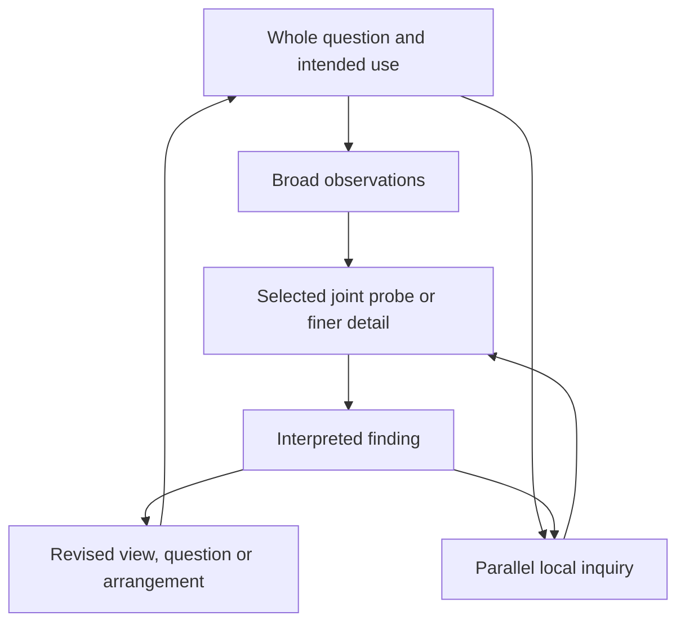

# Understanding a large system without carrying every detail

A large AI system needs useful views of its work at different levels of detail. A broad view can show how contributions fit together, where a shared limit is approaching, or which assumption several activities depend on. Local inquiry can inspect a particular explanation, source or operation closely. The two forms of observation help each other, and they can continue in parallel.

The whole does not have to fit inside one agent's context. Its relevant relationships must become understandable somewhere in the receiving arrangement. Sometimes a qualified local answer is enough. Sometimes the question needs a joint observation, a more detailed representation or a different division of work. A small sufficient explanation can carry a large consequence.

## Let the question determine the detail

Consider twelve work streams sharing a resource that can serve sixteen units in each time period. Each stream requests four units during one of four periods. Two arrangements have exactly the same local totals, averages and peaks:

| Observation | Spread across four periods | All requests arrive together |
|---|---:|---:|
| Units per stream | 4 | 4 |
| Total units in the whole interval | 48 | 48 |
| Average total demand per period | 12 | 12 |
| Total demand in each period | 12, 12, 12, 12 | 48, 0, 0, 0 |
| Highest simultaneous demand | 12 | 48 |
| Within the limit of 16 each period? | Yes | No |

If the question is how many work units were requested, the interval total is sufficient. If it is whether the shared resource can serve each period, timing matters. The broad observer needs the demand pattern and the shared limit. It need not read every work stream's complete task history.

These are stipulated teaching cases. They show how a question changes the information needed; they do not measure the throughput of an actual twelve-agent deployment.

Reducing detail is useful when it preserves the distinction the receiving decision consumes. There is no universal summary that preserves every possible future distinction. A later question may need another view, a source return or a reconstructed observation.

“Complete selected knowledge” is compatible with this selectivity. A complete explanation of the resource relationship can be a small artifact in its own right. Its reader need not acquire all the source histories used to construct it. When the reader requests one particular source body, however, a navigation label or an unexplained summary should not be passed off as that body.

## Broad observation and local inquiry reveal different gaps

The demand pattern exposes a joint timing problem. It would not necessarily expose missing local work. Suppose each stream's four units belong to two different work items, each using two units. In stream five, replace the second item's identity with a duplicate of the first. All numerical summaries and timing totals remain unchanged. A local comparison with the expected work reveals a missing item and a repeated occurrence.

Local inquiry therefore need not wait for a suspicious broad signal. Broad observation and fine inquiry are useful concurrent activities. When local work discovers a new distinction, it can change what the broader view measures. Here, total resource use can be accompanied by coverage of the expected work, if that distinction matters to the containing question. Increasing time resolution alone would not find the missing identity.

These are relationships, not prescribed agents or permanent stages. One participant can perform several of them. A useful finding can change a different contribution from the one where it was detected. Other work can continue wherever its own conditions remain adequate.

## Spend observation where it can change the answer

A fast system does not need to repeat every earlier check for every new question. A prepared search index can nominate useful sources from a chosen edition. Reading a selected source can then check that particular complete body. Checking the integrity of the whole collection is another task, with its own scope and timing. Keeping these promises clear lets the system reuse work without presenting an old observation as a fresh one.

The same distinction matters when a deployment contains a large research archive. A question about its selected method may need the complete method and evidence of which accepted project supplied it. A separate source reader can check that selection, its manifest and the requested body without examining every unrelated archive. Its return must say that those other files remain unverified. A whole-project audit still has its place when that is the assurance the receiving decision needs.

The active project is also only one source of current understanding. A later correction may have been retained separately while the selected project still contains the earlier explanation. Reading that project's method does not establish the current goal, every owed effect or the applicability of the correction. Choose those additional observations when the question consumes them. When a known knowledge-library body already supplies the needed explanation, acquire it directly; an owner-selection check need not be added to every reading. The [implementation account](implementation.md#acquire-only-the-assurance-the-task-needs) gives the corresponding routes.

Randomness can help decide where to look or how to prepare a large space. It does not automatically make an answer approximate, and a deterministic method can still be selective and efficient. For example, a known source can be acquired directly, while an exact index avoids searching unrelated text. Random physical preparation can also improve later queries while every present answer remains exact.

Sampling gives overlooked areas an opportunity, not a guarantee that all small gaps will be found. If one source among 334 contains a perfectly detectable problem, inspecting 32 distinct sources uniformly has only about a 9.6% chance of finding it. Inspecting all sources once gives complete coverage of those identities; it still does not establish that the question asked of each source could recognize every semantic problem.

The probe matters as much as the sample. Two components can report the same average load while their simultaneous load changes. More measurements of the averages will not reveal that difference. Inspect the shared timing, ask for a concurrency bound, or change the boundary. Similarly, randomly reviewing only the sources returned by a flawed search cannot expose sources that search always excludes.

A quiet sequence can support a probability claim when each inspection has a warranted chance of detecting the specified persistent problem. Changing the policy can be compatible with that claim. Replaying the same observation is not another independent opportunity, and a newly introduced problem has not been inspected by earlier checks. When those detection chances are unknown, exploration can still be useful; describe what was examined and what remains unexamined.

## Keep what the next use needs

Continuing work introduces another scaling choice: what should survive, and what must be examined again? Keeping everything does not mean reading everything on every turn. Keeping a small summary does not mean it can answer every later question.

An actual restart exposed both sides. The saved material retained a delivery request and a successful receipt, but omitted the complete generated record that a later interpretation named. The request did not contain its generated timestamp and normalized fields. The older interpretation could be recovered, but one of its exact evidence files could not be reconstructed from the retained means. Other accepted outcomes still supported useful current work. The correct continuation preserves that missing occurrence and makes a new current judgment from the evidence actually available.

For a future delivery, retaining the actual produced record closes that particular gap. A snapshot can be accompanied by a small later package containing the exact additional support a declared continuation consumes. The package's scope should be explicit. It can supply bytes without repeating the original write or pretending to include its own future save receipt.

The Attention reader had the opposite problem. It reread every historical assessment receipt to decide the treatment of one current question. The useful current relation is narrower: which assessment was last appended for this item under its present question, use and sources? A maintained selector can answer that while the complete receipts remain available for historical inspection.

The selector must preserve the right distinctions. If a question uses source basis A, changes to B, and later returns to A, the earlier A account can become applicable again. Retaining only the last account for the item loses that possibility. Current source and product checks also remain necessary; an old assessment is not evidence that today's source is unchanged.

This change reduces repeated reading in the tested arrangement. It adds metadata, update work and an initial rebuild for older state. The useful choice depends on the whole cost and the receiving duty. A deterministic exact selector is suitable here because the treatment rule is already specified. Random exploration serves other questions, including where to look for a previously unknown gap.

Historical recovery, present understanding and permission to act are different relationships. A research result can remain accepted while a delivery is still owed. A record of a past successful action does not by itself authorize repeating it. Retain the support needed by each relationship and let the next recipient inspect the particular claim. The [source notes](reference-notes.md#retaining-useful-state-for-continuing-work) identify the detailed research and operational pattern in the separately selected companion.

## Let a smaller view change the work sensibly

A smaller handoff can do more than save reading. If it contains a useful accepted explanation and a route to the few sources that matter next, its recipient may be able to continue with a simpler operation. A known source can be read directly. A current owner can supply a needed fact. An established command can perform settled work without another model planning it.

A smaller view can also leave more work for its recipient. It may omit a distinction that now requires reconstruction, another source or review. The useful comparison therefore follows the whole contribution: preparing the view, receiving it, filling necessary gaps, checking the result and completing the owed work. Fewer words in the first message do not alone establish a cheaper or better result.

The purpose matters. An account sufficient to review a proposed change may not establish that a live system is ready to apply it. The latter question can need current ownership, unfinished work and the outcome of an earlier action. Asking that new question does not make the earlier review wrong. It changes which information must now participate.

The same principle applies when choosing a model or another participant. A participant that receives only difficult escalations has a different workload from one that receives known-source questions. Judge each route on the work it actually receives and the complete result it enables. A fast first response can still leave a slow queue of corrections.

When replacing a session, keep three things distinct: the useful understanding already developed, work and service still owed, and the resources the new route will need. A new session name should not erase a task's original age or promised deadline. A shorter context should not silently reuse an estimate made for a different way of finishing the work.

The [source notes](reference-notes.md#continuing-work-through-changing-representations) identify the conditional arguments and actual receiving scope.

## Understand the particular composition

Good separation makes some questions locally answerable. If a component promises an answer that actually depends on unexposed distant state, its boundary or explanation needs repair. Expose the needed condition, move the responsibility, or change how the result is obtained.

Other properties belong to the composition itself. The twelve streams can each obey their local rule while together exceeding a shared limit. Their separation is not thereby wrong. The shared question still needs the relation between their timing and the available capacity.

Even all pairwise summaries can omit a relevant joint distinction. Consider three binary properties. In one illustrative source, the four equally likely outcomes are `000`, `011`, `101` and `110`. In another, they are `001`, `010`, `100` and `111`. Every individual property is equally often zero or one. Every pair has the same four equally likely combinations in both sources. Yet the first source always has even parity and the second always has odd parity.

If the receiving question depends on parity, those individual and pairwise summaries cannot answer it. The same evidence permits opposite answers. A joint probe or another sufficient source is needed. This does not require examining every possible grouping in every system: the useful observation follows the actual question, available understanding and consequential unknowns.

The practical aim is to discover which relationships matter, then make them economical to inspect. A new interaction can justify a temporary joint investigation, an overlapping view, a changed interface or a reusable explanation. It need not force every participant to acquire the whole system.

## Turn selected meanings into useful signals

A signal is a compact observation with an interpretation. It might represent simultaneous demand, a changed assumption, the age of an unresolved question or a qualitative disagreement. The relevant meaning determines which comparisons are legitimate.

Twelve reports of “one issue” could describe twelve distinct problems or twelve observations of the same problem. A falling overall failure proportion can coexist with a worsening smaller group. Observations made at different times can appear contradictory when the source changed between them. Before processing such signals together, establish the particular scope, denominator, timing or shared cause the comparison needs.

This is where aggregate computation helps. Once a meaningful observation has been constructed, a program can calculate totals, trends, lagged relationships or selected combinations over many contributions. The interpreter supplies and revises what those quantities mean. A correlation can nominate a relationship for investigation; it does not by itself identify the responsible producer or the appropriate repair.

Keep a route from a suspicious signal to a useful example, local participant or underlying source. Also allow a local finding to revise the signal's definition. A dashboard that can only change numbers within fixed categories may conceal the most consequential new understanding.

## Keep representations aligned through their junctions

Research, operating guidance, human explanations and software can represent the same understanding differently. Alignment means that their relevant consequences agree for their intended uses. It does not mean copying every detail or making their wording identical.

A **junction** is a place where one representation's meaning participates in another's explanation, decision or production. It may be a shared assumption with no matching phrase or explicit link. References, source identities and search can help locate it. A capable interpreter must still determine whether the connection matters.

Consider a project that replaces separate general manuals with one shared knowledge collection. The implementation explanation still begins by telling readers to start a work runtime. Its command example selects an old manual entrance, now a short compatibility page. Updating the library alone leaves this receiving instruction misleading. The junction is what the reader is being told to acquire and do.

A useful correction can proceed as follows:

1. **State the consequential change.** Agent understanding and continued research now enter through the shared knowledge collection; a durable work runtime is optional support.
2. **Probe other representations.** Ask where a human reader is told to begin, what an agent is given as operating knowledge, and what a preparer actually acquires. Search for consequences and alternative wording as well as exact old phrases.
3. **Inspect the candidate junction.** Determine whether the local body already supplies the new relationship, teaches the old one, or leaves a needed condition unstated. A matching keyword alone does not decide this.
4. **Change the responsible contribution.** Revise the instruction, selected source, resolver or explanation that produces the problem. An adequate source body can remain unchanged.
5. **Use the correction.** Let the next recipient follow the revised route. Its actual answer or work can show whether the new relationship reached the intended use.

Repeated use can make a discovered junction worth retaining. A changed purpose can make another junction relevant or retire an old one. This allows a sparse, developing map of useful relationships rather than requiring an exhaustive inventory of every possible reference.

An exact source-change check and a semantic probe serve different purposes. The first can detect that a nominated body changed. The second can discover that a different explanation or operation should change as a consequence. An unchanged source can also become relevant to a newly changed question.

## Judge coverage against the intended use

A human introduction may need to explain what the system offers and how to choose a starting point. It need not reproduce every proof or runtime command. An agent's selected context may need a particular operating relationship while leaving unrelated research available elsewhere. Their coverage is judged against those purposes.

Ask what the representation enables its recipient to distinguish or do, which relevant contributions come from another participant or recoverable source, and what remains unexamined. A count of included files cannot answer these questions. Intentionally omitted detail can be appropriate; an absent distinction needed for the promised use is a gap.

For example, an overview can show where a shared capacity matters and how to obtain a timing observation. A local guide can explain how to produce that observation. A further recipient can compare it with the actual limit. The useful coverage lies in the joined passage, even though no single representation contains everything.

When a question changes, reconsider the coverage. A view adequate for explaining total work may become inadequate for judging simultaneous demand. A new local finding may reveal that the old question was too narrow. The representation and the understanding of the whole can develop together.

## Choose the next useful contribution

| Present situation | Useful next contribution |
|---|---|
| A known relevant source changed | A scoped ping and current receiving interpretation |
| The broad question needs less than the local detail | A sufficient explanation, signal or qualified local answer |
| A small local uncertainty remains | Focused inquiry that can continue without a broad alarm |
| Locally adequate parts have an uncertain joint effect | A selected joint probe or revised arrangement |
| A changed meaning may survive in other wording | Consequence probes at candidate semantic junctions |
| A view is intentionally partial | A clear account of its intended contribution and remaining access routes |

Use existing means when they already supply the relationship. A concrete tool limit may justify changing the tool or the receiving arrangement, but the limit does not define the whole theory of scaling. The [implementation account](implementation.md) distinguishes the current knowledge component, optional work support and their actual boundaries. [Shared systems](shared-systems.md) explains recoverable changes and personal working views. [Source notes](reference-notes.md#selective-composition-and-representation-alignment) identify the evidence and illustrative scope of this chapter.

The next question can concern the observation itself: what a probe should distinguish, how its return changes another contribution, and which broader inquiry that opens. [Probing and learning](probing-and-learning.md) develops that passage through a concrete source-use example.
