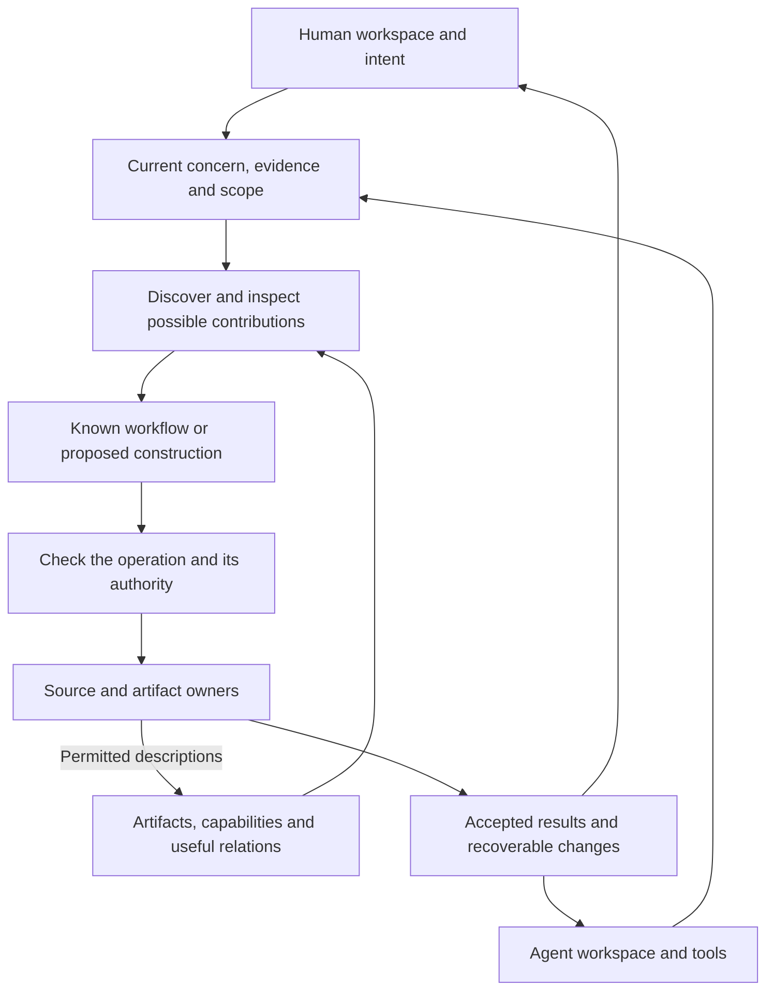
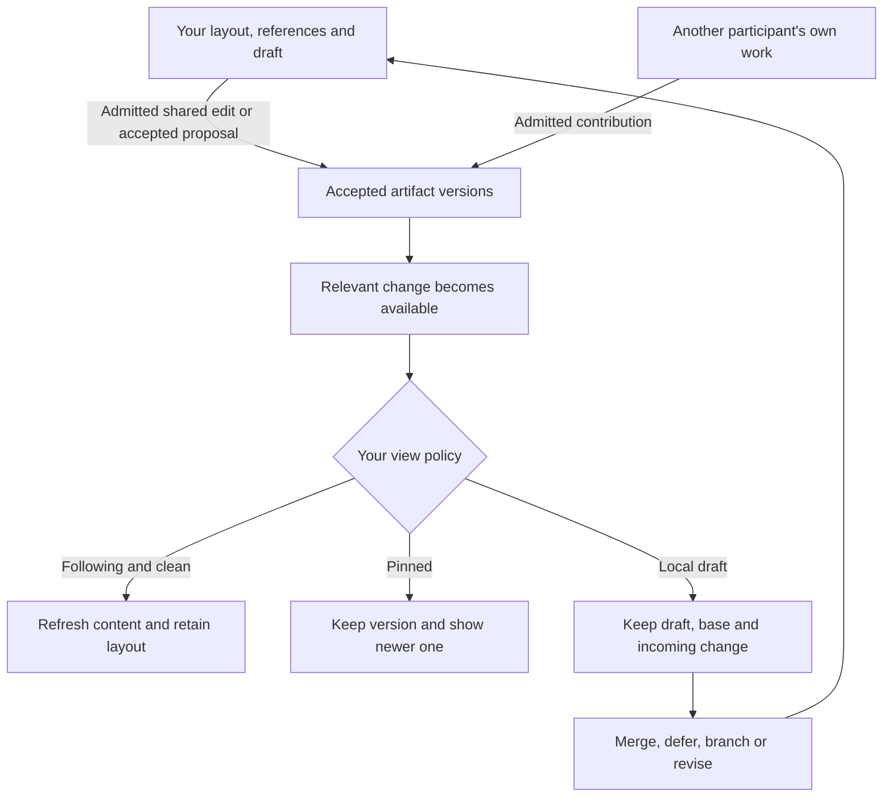

# Personal work, shared artifacts and discoverable possibilities

One desk can report that a drawing is ready while a different desk knows the wall has moved. Ask who can still stop the installation, then look at the actual placement. An earlier approval remains useful for understanding why the work was attempted. [Who owns a change?](../../domains/research/sources/knowledge/research/patterns/receiving-boundaries.md)

An AI system can give people and agents their own working spaces while letting them contribute to the same artifacts. A person may arrange a canvas around a question. An agent may retain a compact context and selected references. They coordinate through visible evidence, accepted versions, proposals and changes, while keeping their own interpretations and ways of working.

This chapter connects the individual [software patterns](software-patterns.md) into that larger arrangement. It is complete within this human guide; the diagrams describe responsibilities and exchanges rather than requiring a particular product or deployment.

## The pieces of the system

The interface lets a participant express a concern and examine the work. Discovery exposes relevant possibilities. A person, model or maintained procedure supplies the interpretation needed to choose or construct a contribution. The execution boundary checks what is actually permitted. Artifact owners retain accepted state, and change information reaches participants whose work may be affected.

Several boxes may live in one application. A team may instead place artifact ownership and shared work remotely while keeping each participant's personal arrangement locally. The important question is who owns each state and what crosses each boundary.

| Place in the larger arrangement | Smaller patterns that make it work |
|---|---|
| Editor, intent bar and canvas | Scoped presentation state, question identity, temporary resource ownership and approved renderers |
| Orientation and discovery | Contextual candidates, inspectable reasons, relational anchors and coverage limits |
| Tool execution | Current permissions, credential mediation, named commands and outcome receipts |
| Data and artifacts | Owner-controlled projections, versions, publication and meaningful writeback |
| Continuing collaboration | Following or pinned references, change subscriptions, draft reconciliation and work readiness |

## Two useful deployment extremes

Consider the same neutral activity: develop a useful explanation from some notes.

In an **open local workspace**, the user brings their notes. The application can obtain approved presentation modules and capability descriptions, then assemble a suitable sequence around the selected concern. The notes can stay on the device. A remote provider receives only the information deliberately sent to it. A private result can be edited, discarded or offered as a shared contribution.

In a **constrained service application**, the service owns the accepted notes and exposes a defined page with a known operation. The client already contains the relevant presentation library. Selecting “produce the overview” may invoke an established workflow directly because the page and action have already supplied its meaning. The resulting artifact is saved under the service's authority and sharing rules.

| Decision | Open local illustration | Constrained service illustration |
|---|---|---|
| Source authority | User's local repository | Authorized service repository |
| Available environment | Approved capabilities can be acquired or composed | Page, components and workflow are already installed |
| Unsettled question | Which contribution and combination would help? | Often only required inputs or the artifact's content |
| Result | A local artifact, optionally published | An artifact accepted by the service |
| Typical feedback | Discover, try, inspect and revise the composition | Execute, inspect the result and revise the artifact |

These are combinations of independent choices. A local application can have fixed workflows, and a remote service can support open construction. Selecting a known operation, loading an approved component and admitting a newly developed executable are different contributions. Each needs its appropriate use and authority; loading alone supplies neither interpretation nor review. The [capability example](worked-examples.md#a-new-question-can-reuse-a-developed-capability) shows a developed operation entering a running host and then serving a changed question. [Local-first software research](https://www.inkandswitch.com/essay/local-first/) explores how local ownership, offline use and collaboration can coexist.

## Helping someone discover what they want

A person may arrive with a precise instruction, a vague concern or no direction at all. The interface should support all three.

A precise instruction can use an established operation immediately. A concern such as “I am losing track of changes” can lead to options that explain what they would reveal or improve. An empty workspace can offer grounded starting points: examine something the person has, resume changed work, explore available capabilities, or introduce another concern. The system should reveal what information supports those offers.

The **frontier** is this current view of useful possibilities. It can be generated from an ecosystem even when no task list exists. It does not imply that the system has considered every possible direction. The participant can inspect why an option appeared, compare consequences, change the concern, select something outside the offers, or dismiss them. An empty selection is valid: completing a contribution need not produce a new task list.

This connects to established work on [mixed-initiative interfaces](https://www.microsoft.com/en-us/research/publication/principles-mixed-initiative-user-interfaces/), which combines direct interaction and automated assistance. [Human–AI interaction guidelines](https://www.microsoft.com/en-us/research/wp-content/uploads/2019/01/Guidelines-for-Human-AI-Interaction-camera-ready.pdf) also support understandable capabilities, correction and dismissal. The design here applies those ideas to a changing work environment.

A single available workflow is enough for direct execution only when it fits the settled task, has its required inputs and is authorized. Otherwise, the system still has something to learn. Zero search results can mean limited coverage or an unsuitable search, while several results can call for comparison. Candidate count alone does not decide what the person needs.

## Navigation can follow relations

Work does not need one large-to-small hierarchy. An explanation can relate to a source, an audience, an unresolved question and another unfinished artifact at the same time. Any of these can become a useful entry point. An artifact type is one such anchor; a dependency, intended effect or example can be another.

The system can search descriptions, follow explicit relations, offer facets, or retrieve similar examples. [Hearst's search-navigation account](https://searchuserinterfaces.com/book/sui_ch8_navigation_and_search.html) describes established ways to combine browsing and search. The resulting map is useful because its routes help the current inquiry, not because every item has one correct position.

If thousands of items look equal under the available information, the system needs another useful distinction or can treat interchangeable choices equivalently. A ranking number does not create knowledge about their differences. The participant can inspect examples, ask a discriminating question or introduce a new relation.

"Broadest" also need not mean a parent category. It may mean a shared bottleneck, a reusable producer or a change that makes other work unnecessary. A small repair can have a broad consequence. At a meaningful selection boundary, compare the immediate continuation with a concrete wider or sibling opportunity. A worthwhile improvement can justify work beyond an adequate result; the availability of another variation alone does not.

A broad view can preserve the relationships needed for a particular question while omitting local detail. Local inquiry can still discover a small gap independently of any broad alarm, and that finding can change the broad view's categories or questions. The [scaling chapter](scaling-understanding.md) develops this passage through twelve work streams, meaningful signals and selected joint observations.

## Your canvas and the shared artifact

A canvas is a personal arrangement of work. It may show a live reference to a shared artifact, a pinned historical version and a private draft next to one another. Moving a card need only move that personal arrangement. Editing its content and changing who can see it are different operations.

Useful sharing choices include **follow**, **pin**, **copy or branch**, **propose**, and **join shared editing**. The interface should identify which one is in effect. “Saved locally,” “Shared revision accepted,” and “Proposal awaiting review” carry more useful meaning than a single vague “saved” label.

A human need not press “submit” after every keystroke. In a chosen shared-editing mode, the application can continuously send edits under the existing permission. A private draft can remain private until publication. The distinction is in the object's mode and authority, even when the interface makes the operation fluid.

Automatic merging can settle some concurrent edits. It does not decide whether the resulting explanation is sound or whether a changed premise invalidates another artifact. [Automerge's conflict documentation](https://automerge.org/docs/reference/documents/conflicts/) makes visible how conflicting assignments can remain available despite a consistent displayed result. Further interpretation can still be necessary.

## Knowing that something changed

Participants should not have to probe the entire shared environment repeatedly. An artifact owner can retain a change sequence and let interested participants subscribe or catch up from their last known position. A disconnected client can then discover missed changes, or receive a clear request to refresh if the retained history is insufficient.

What the human sees can be a quiet badge, a grouped change list or a comparison panel. An agent can receive a wake-up with references to inspect. Both need the source and the reason the change may matter. [Workspace-awareness research](https://www.cs.usask.ca/faculty/gutwin/1999/WA-theory/Theory-submitted-TR.html) frames this as deciding what collaborative information matters, how to expose it and when it is useful.

A clean following view can refresh. A local draft needs preservation and reconciliation. A pinned view remains pinned. Notification delivery alone cannot choose among these meanings, and a connected socket is not proof that all changes have been received.

The same distinction applies to blockers. “Ready to continue” is a useful signal that a recorded condition changed. The work owner must still check readiness when a participant claims the work, because another blocker may have appeared. Someone's cursor, an agent's presence or a reassuring status message is not proof that a prerequisite was completed.

Some relevant relationships have not yet been recorded. A changed assumption can persist in another explanation under different words and without a direct reference. Probe what that recipient would now explain or do, inspect the resulting candidate junction, and update the responsible body when its consequence is stale. A known subscription then carries later changes along the discovered route. [Representation alignment](scaling-understanding.md#keep-representations-aligned-through-their-junctions) explains this semantic work without requiring every relationship to be indexed in advance.

## Keep unrelated work able to proceed

A finding addressed to one artifact need not invalidate another participant's proposal. Both participants may still share a resource needed to save their work. An operation that eventually refuses can occupy that resource while collecting information it never needed for the refusal.

For example, finding 129 required notices tells the desk that its 128-notice direct context cannot fit. The desk can keep its proposed change, examine the offers separately and preserve its judgment about each. Checking the full set at publication catches a notice that arrived while someone was reading. The reader can use a larger or different interpretation if the individual decisions conflict.

This improves one part of the arrangement. It does not give each participant a separate database writer or establish a bound on waiting. The useful distinction is between work whose meaning remains valid and work that can obtain the shared capacity to act. A broad view may need to observe rejected attempts and their resource use as well as accepted changes. The [source notes](reference-notes.md#scoped-duties-and-admission-work) identify the implementation study and its limits.

## Consolidate without losing the distinctions

Two people can report similar symptoms and still need different outcomes. Suppose a workspace summary and an exported report both show English headings after Spanish is selected. It is useful to investigate their text sources together. That does not yet establish one defect or one repair. A later finding might show that the summary contains the author's literal project title, while the export contains an application label. The title should stay as written; the application label should follow the interface language.

Keep both original reports and make the meaning of their grouping explicit. A group can mean one investigation, one underlying issue, one sufficient repair or one intended action. Those are different relationships. The current interpretation can change while the original observations remain accurate. A shared investigation can remain useful even after its reports acquire different dispositions.

Store the current grouping together with the work it proposes. A worker whose next action depends on that interpretation should use its current accepted revision. When a finding changes the interpretation, follow it to the actual instruction, review question or action. Renaming a group while its worker continues with the old blanket instruction does not complete the revision.

There are two moments to distinguish. A new finding can require consideration before a revised grouping has been accepted. If dependent work must wait at that moment, its owner needs that actual finding or another condition it checks. Merely knowing that the work used the old grouping does not automatically carry every pending concern to it. Once a revised grouping is accepted, checking the worker's captured source can identify its old basis as stale. Useful earlier output can still be retained and assessed for the new use.

The same arrangement helps with story and research consistency. A death followed by speech may be a contradiction, a flashback or a character's mistaken belief. A research difference may depend on a population, definition or assumption. First determine the question and the relevant scope. A useful consistent view can explicitly say that two claims conflict and that the current evidence does not settle which to revise. It need not hide disagreement or declare a permanent final truth.

Some work needs stronger agreement before acting. If only one participant may perform an action, later catalogue cleanup cannot undo two completed actions. The current action owner must check the shared condition before admission. Two independently current records do not by themselves establish that no competing action exists. Repeating a delivery also differs from performing its downstream action again; the actual owner must retain or recover what happened.

An available coordinator can receive and delegate promptly while downstream work still falls behind. Combining compatible messages can save repeated interpretation, but distinct owed work remains. Keep enough recoverable state to resume after interruption, use bounded active participation, and observe delays or repeated reconsideration that matter for the actual promise. A single integration session can be adequate when its capacity and common context fit the work. A larger arrangement can give independent scopes their own interpretation while retaining a short shared acceptance operation where needed.

Session context is valuable working memory. The accepted view, unresolved questions and recovery routes keep later work from depending entirely on that one session's survival. The [source notes](reference-notes.md#continuous-consolidation) distinguish the constructed receiving example from broader performance and convergence claims.

## Memory, participants and actions

The memory system is one part of the larger arrangement. It keeps useful evidence and interpretations, helps people or models find them, and supports later revision. A runtime arranges attempts and their lifetimes. An action owner decides whether a particular change can take effect. Storage supplies the persistence and concurrency those participants need. One application can perform several of these roles; a growing system can separate them where that helps.

Using retrieved knowledge to help a model produce an answer is retrieval-augmented generation, often called RAG. The same knowledge can help a person inspect a situation, challenge a conclusion or perform work. A human interface is therefore a participation environment: it should expose the right context, preserve a person's unfinished contribution and make the meaning of an action clear. Recording a report is distinct from deciding that it is true or adequate.

No single participant has to merge every possible relationship before anyone can proceed. Several groups can investigate overlapping areas and consolidate their findings over time. Let a grouping mean what it actually supports: investigate together, share an explanation, use one repair, or perform one action. Two similar reports may need different actions; two differently worded reports may concern the same action. Preserve the reports while those interpretations develop.

There is a limit to unseen duplicate prevention. If either of two isolated workers may independently complete its task, and neither has a shared action identity or exclusive right, each can act before learning that the other had the same task. Later cleanup cannot undo both performed actions. It can still be useful to permit duplicate investigation and reserve stronger agreement for the particular action whose duplication matters.

Replacing a long session illustrates the distinction. A new session can read a compact account while the old session continues useful work. Keep new arrivals and unfinished duties somewhere the successor can catch up. When transferring action ownership, the actual action receiver must reject obsolete requests or otherwise settle them. A note that the old session is finished does not stop a delayed request already on its way. Preserve the original action identity and outcome so the successor can recover a lost confirmation without doing the action twice.

This can leave independent work running while one part changes hands. It does not promise that the changing part needs no brief pause. A weekly cleanup rule or an age threshold can be practical, but its adequacy depends on what future work may need to recover. Large session text and small action receipts can have different useful lifetimes. The [source notes](reference-notes.md#ai-ecosystem-and-live-succession) explain the inspected implementations and bounded study behind this account.

## What this arrangement makes possible

Humans and agents can participate through compatible external contracts while retaining different working contexts. They can inspect the same artifact, disagree about its meaning, propose alternatives and receive relevant changes without sharing one canvas layout or loading the entire environment.

The remaining design choices concern actual use: which changes deserve interruption, which relations are worth following, where automatic merge helps, and how the participant recovers from a misleading suggestion. The [software-pattern guide](software-patterns.md) supplies the smaller implementation mechanisms. The [inquiry guide](inquiry-and-access.md) develops how new questions and useful observing means can emerge through this participation.

## Follow the direction all the way to pickup

Suppose you are sending a courier to an evening pickup. You can read yesterday’s desk notice and quote exactly what it said. The venue can change the pickup door while you prepare the direction. It owns the moment your message first appears on its board. Checking the edition and permission there keeps an old direction private. The venue can still publish a mistaken reading of the correct notice. Sending someone to the door printed on the board supplies a different kind of feedback. [Walk through the example](../../domains/research/sources/SYSTEM.md#historical-implementation-references).

You can report that one problem is repaired while another still blocks pickup. Describe what the courier actually tried, the edition the attempt used and which earlier concern it settles. When the same attempt reveals a new difficulty, keep that new duty visible to whoever can change the next handoff.

## Returning after an interruption

A passenger changes the time they need to transfer between two trains. The published timetables still serve the print desk. The passenger may need a different connection. A useful progress view lets you answer both people, inspect the reason, and ask the timetable owner for an amendment when it helps. If the amendment still leaves the passenger short, its availability is worth showing with that limit. You can [operate the desk](../../domains/research/sources/SYSTEM.md#historical-implementation-references) from the release.
