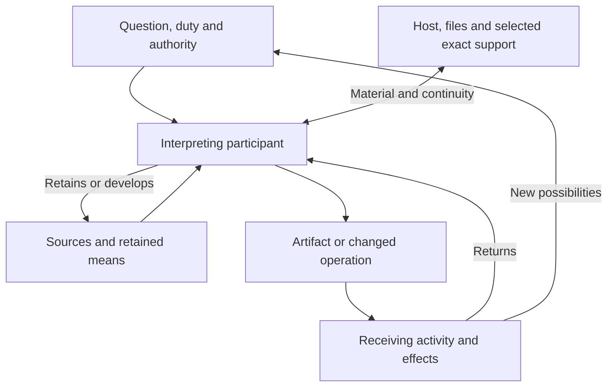

# A system that develops how it works

G60 proposes an organization that develops useful contributions and the means of making them. An explanation can give its reader a new question; an observation can change the explanation or its producing procedure. Existing capabilities remain available for direct use, and a finished contribution need not generate another task.

The applied arrangement uses a language model or person for interpretation, with files and exact tools supporting continuity and execution. The exhibition below is an authored teaching example. [What is built](implementation.md) describes the available software.

## 1. Begin with a contribution someone can use

Imagine three accurate exhibition captions: a cup has a repaired handle, a ticket has a printed date, and a notebook contains measurements. The records identify no repairer, ticket user, measurement purpose or common history.

The brief asks for an optional invitation to investigate relationships among the objects. Keep the captions accurate, leave originals untouched and allow participation without writing. The invitation might be a card, spoken question or arrangement of reproductions. An *artifact* is anything that can enter the work, including a partial design or question.

## 2. Follow the prediction far enough to change the work

The hypothesis is that an invitation could help a visitor construct an inquiry. A proposed connection might call for another source, a comparison or a distinction between historical support and fictional association.

Work backward into the invitation. A first draft says:

> Choose two objects. Tell the story that connects them.

“The story” can imply an established answer and asks for a finished narrative. The [worked chapter](worked-discovery.md) instead constructs a card asking which relationship is worth exploring, what supports a beginning and what would help develop it. Visitors may point, speak, sketch or keep looking.

The forecast changed the artifact and exposed a reusable distinction: inviting a relation serves a different purpose from establishing a fact. Actual visitor reception remains a separate question.

## 3. Develop the relationship through which the result is received

A staff note helps the offered question enter further work: attend to the actual connection, identify its support and find a useful next source or comparison. The invitation and its receiving practice develop together. An archivist, educator and visitor can use the same material for different purposes.

These roles can share a participant. Their composition matters: accurate captions under an unsupported common-history heading can make a misleading whole. Repair can change the heading while preserving the captions. The perspective exposing the problem need not own its repair.

## 4. Reuse what is settled; discover what the current use lacks

An approved reproduction procedure can run while the invitation develops. A *constructed space* retains meanings, sources and operations supporting a family of uses. An adequate source may supply a missing contribution, or another producer may remove its need.

The desired contribution helps us predict which understanding to seek. Research can explain why a relationship works and what remains unsettled. A design pattern can arrange the responsibilities it needs. An implemented component can perform a particular observation or effect. A retained specialization can carry a useful combination, the sources it draws on and the conditions introduced by their co-use. One body may supply several of these contributions to a developing library; they are not a fixed list of subject areas.

Consider a second authored illustration: combine writing support with marketing support to produce an invitation. Clear, confident wording can make it easier to understand while implying a promised result that the supplied description does not establish. The new relationship lies between the wording, its support and what the reader can reasonably take it to promise. We might change the wording, seek adequate support or revise the intended claim. Merely listing the two parent contributions would leave that relationship unexplained. This is an illustration, not an observed marketing result or an installed domain module.

A useful specialization keeps its arrangement and new condition intelligible, with the sources or reconstruction routes that later use needs. A relation to an earlier contribution might explain its origin, supply a current dependency, offer a contrast or provide an alternative. It need not make every parent a permanent prerequisite or keep every earlier body inline. Another use can then find the specialization, understand why it was made and adapt it. An explanation of that condition can extend the research; a recurring arrangement can become a reusable pattern. Neither requires a universal hierarchy in which writing or marketing owns the other. The [shared-system chapter](shared-systems.md#navigation-can-follow-relations) explains discovery through several relationships, and [pattern use](software-patterns.md#use-a-pattern-library-inside-the-construction) shows how a selected body changes a design. In the current application, bounded search and authored links bring candidate sources into reach; a person or model supplies the interpretation. A search result is not an answer to the whole design question.

A correct operation and a useful question require different judgments. An annual-growth calculation may fit its source exactly while answering the wrong question for a briefing. A better question can reuse the same operation. The [recorded capability example](worked-examples.md#a-new-question-can-reuse-a-developed-capability) follows that distinction into actual receiving work.

## 5. Retain a way to continue

Useful memory includes the card, source limits, receiving note and contrast that changed the first draft. A slogan such as “ask open-ended questions” may lose the relationship; retaining every sentence of the development may add little.

Keep a result, operation, contrast, unfinished duty or source route according to later use. Another exhibition can reconstruct the useful distinction through different words and objects. Where the duty concerns what someone actually said or which operation ran, retain that occurrence. [Memory and re-entry](foundations.md#memory-and-re-entry).

## 6. Let the result reopen the wider choice

Reconsider what is now worth doing. Further wording, an arrangement of reproductions or an authorized visitor encounter could each serve a particular contribution. A small repair may unblock the whole use; another arrangement may remove the problem.

The completed card also permits stopping. An unobserved visitor effect matters if a decision needs that evidence; it does not automatically prevent delivery of the commissioned draft. Select a consequential continuation, or keep the result available until another use calls for it.

Compare complete arrangements when economy matters. A shorter card may need more staff explanation. Shared preparation may relocate work. A stronger producer may remove handoffs and upkeep.

## 7. Put interpretation and exact support in contact

A model or person supplies interpretation and construction. A host supplies access, continuity, delivery and authorized effects. Ordinary files or an existing application can supply that host.

Prototype **0.4.1** provides optional collection, exchange and attention support. It retains actual command outcomes, selected context, replies and proposed artifacts; publication is a separate effect. Its system examples illustrate fixed workflows and admission of a reviewed operation into a running host. The [implementation chapter](implementation.md) distinguishes those demonstrations from the core and explains how to use them.

## 8. The work can change its own means

The example leaves an invitation, a distinction and a receiving practice. Later work can reuse or revise them. The artifact, observer, receiver and process can all become material for construction when a useful contribution calls for it.

The applied hypothesis concerns the usefulness of this model-plus-artifact organization. General benefit and complete economy require their own evidence. Autonomous origin asks a stronger question about how capacities arise under declared starting conditions.

Read the [complete construction](worked-discovery.md), [foundations](foundations.md) or [different interpretations working together](reciprocal-construction.md) as needed. [Source notes](reference-notes.md) retain support; the [80-post series](story.md) preserves the longer teaching history.
