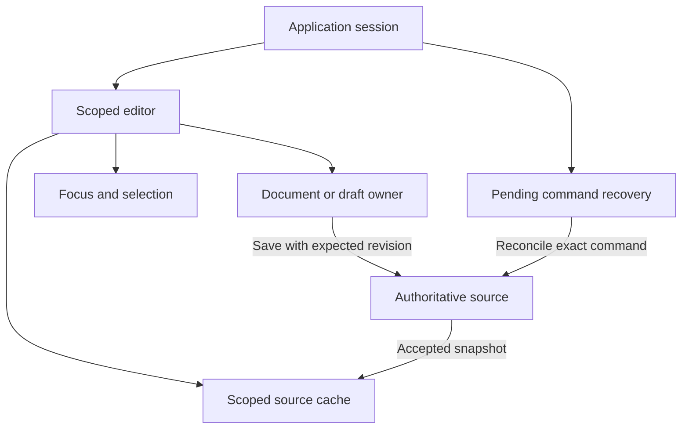
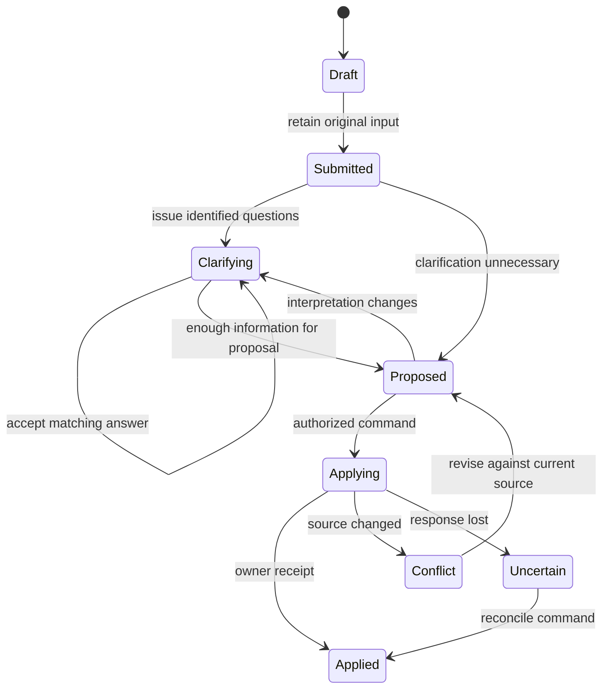
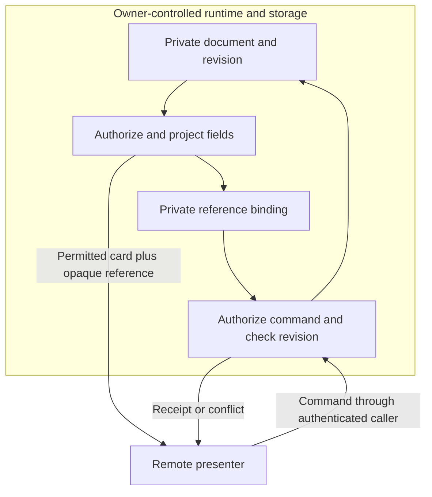
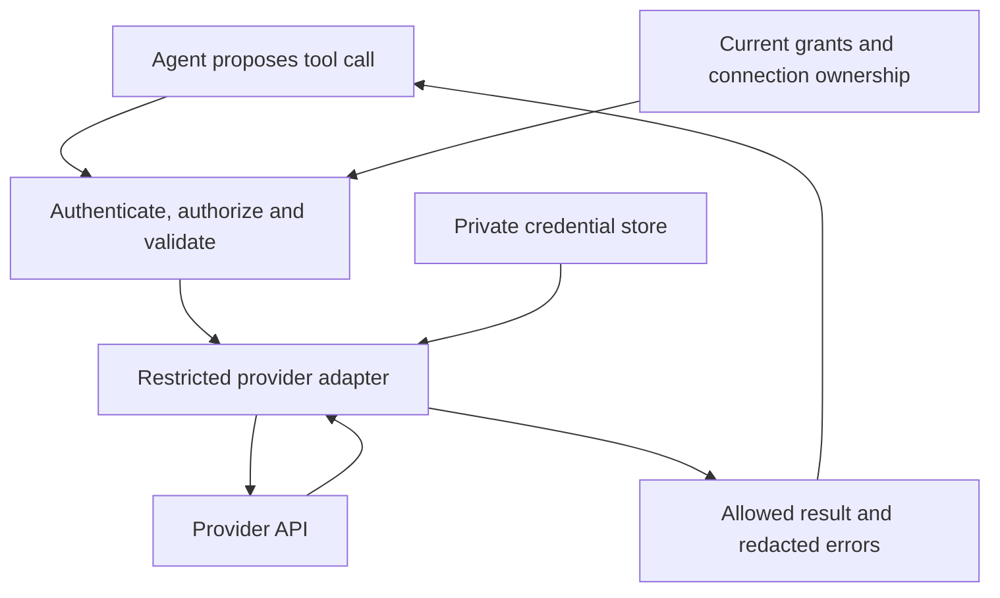

# Software patterns: from a useful idea to a reliable interface

The theory explains how a person or model predicts a useful contribution, seeks missing knowledge, composes a construction and learns from its return. Software patterns make the resulting system usable: they specify where state lives, what crosses a boundary, how an edit becomes an accepted change and how a late result is handled. Learn these mechanisms individually, then choose the combination your application needs.

The examples here use generic documents and annotations. Each mechanism has a known architectural basis; their combination around human and agent participation is the adaptation. The optional prototype supplies small demonstrations and an integrated editor for comparison. This chapter is complete without installing either.

## A map of the patterns

| Need | Pattern and reason | Typical implementation |
|---|---|---|
| Several panes share editor controls | A session-owned presentation model keeps UI state coherent | React reducer/context or scoped Zustand |
| Read remote data and switch workspaces safely | A scoped query cache and guarded async completion distinguish current work from old work | TanStack Query, cancellation and generation checks |
| Guide an intent through clarification | A guarded state machine ties answers to actual question identities | Reducer or statechart; XState when complexity warrants it |
| Carry uploads and drafts temporarily | Explicit resource ownership makes cleanup and promotion predictable | Temporary handles, expiry and a resource registry |
| Select components or pages dynamically | A validated descriptor resolves through an approved registry | React lazy chunks and schema validation |
| Show data while its owner keeps originals | An owner-side projection emits a permitted transfer object | Local adapter or authenticated owner gateway |
| Keep a changing view current | Recompute, materialize or incrementally maintain a read model | Query, cache, database view or projector |
| Save once despite retries and other edits | A conditional command plus idempotency record protects the actual effect | Transaction, revision check and receipt |
| Use integrations without exposing keys | A credential broker authorizes and executes a restricted tool | Connection store and provider adapter |
| Retain what a user actually said | Source evidence is recorded separately from interpretations | Ingress record plus attributed proposal |
| Share discoveries across users | Explicit artifact versions, grants and dependency disclosure | Tenant-aware repository and publication operation |
| Find useful patterns while designing | A capable host selects knowledge and revises its construction | Search/catalogue plus model or human judgment |

## Give each state a home and a lifetime

An editor can have shared state without putting everything into one global store. Focus and selection belong to the current editor. An unsaved document belongs to its draft or document model. A fetched server record belongs to its source; the browser holds a derived cache. A command that might already have committed needs recovery information that can outlive the editor that sent it.

Zustand is useful when several components need selective access to shared editor state. Create the store for its actual owner—for example one mounted document editor—and provide that instance to its children. A rich-text editor may already own document transactions; keep its selection identifiers or surrounding controls in Zustand rather than create a second writable copy of its document. React's guidance warns about contradictory, redundant and duplicated state. TanStack Query provides a different responsibility: caching asynchronous source data under keys that identify the data. [React state structure](https://react.dev/learn/choosing-the-state-structure), [TanStack query keys](https://tanstack.com/query/latest/docs/framework/react/guides/query-keys).

When a user changes workspace, mount or select the new scope deliberately. Cancel obsolete reads where possible and check identity before admitting their results. Aborting a fetch does not undo a server action. Keep a pending command's original target and ID so its result can be reconciled even after the originating editor disappears.

## Make the intent bar a protocol

An intent bar captures a request. A proposal contains a particular interpretation of that request. A clarification question belongs to that proposal and has an identity. Answering step two must mean answering that specific question, not whichever question later occupies position two in an array.

The actual interaction may permit skipping, revising or adding questions. The state machine specifies the allowed transitions and checks their conditions. It should not force clarification when the request is already understood. A simple reducer may be sufficient; hierarchical and parallel behavior can justify a statechart implementation. [W3C SCXML](https://www.w3.org/TR/scxml/) describes state machines, transitions and guards; [XState](https://stately.ai/docs/machines) is one implementation option.

For example, an answer can carry `intentId`, `proposalRevision`, `questionId`, `questionRevision` and its value. If the proposal changed, the receiver can reject or explicitly migrate that answer. The interface keeps the typed answer available for the user to reconsider. It does not silently attach it to a different question.

## Preserve the user's words without confusing evidence with authority

Retain the exact text received at an authorized ingress boundary, together with its source identity and time. Store the agent's interpretation, proposal and later decisions separately, with references to the source. A correction can then change the interpretation without rewriting what the user supplied. W3C [PROV](https://www.w3.org/TR/prov-overview/) provides a vocabulary for entities, activities, agents and derivation.

This makes misrepresentation inspectable; it cannot force a model to interpret the source correctly. Source text may itself be ambiguous or contain instructions that have no authority in the current task. Data received from a document or tool is evidence to interpret, not permission to execute an action. Raw-input preservation also needs access and retention rules; it is not a requirement to keep every message forever.

## Present data while its owner keeps custody

Suppose a user has a private document with a title, body and a private note. A separate presentation service needs only a short card. The owner decides which fields may appear and computes that card in a trusted runtime. The private note does not leave just because a remote service supplies the card layout.

Here is what the diagram requires:

1. **Authenticate the caller at the owner boundary.** The owner obtains a verified identity; it does not trust a role or tenant written in generated JSON.
2. **Choose a deliberate output shape.** Build a new object such as `{schema, title, annotation, viewRef}`. Do not serialize the entire source and try to hide its private fields in the UI. Metadata, errors and tracing fields also count as disclosure.
3. **Retain the binding privately.** The owner stores what `viewRef` denotes: the source, revision, authorized subject and audience, permitted operations, and expiry or revocation conditions. A remote reference does not need to contain the original data.
4. **Check every use.** Possessing the reference does not grant access. The owner checks the authenticated caller and current policy before returning information or accepting a command.
5. **Apply only a defined source operation.** An edit to the card's annotation becomes a command to the annotation owner with its expected revision. A derived value does not automatically have a valid inverse edit.
6. **Report the actual result.** An owner receipt acknowledges the committed change. A presentation update alone acknowledges only a presentation change.

This combines a [data transfer object](https://martinfowler.com/eaaCatalog/dataTransferObject.html) with explicit field projection, authorization and versioned commands. The DTO pattern supplies a transport boundary; it does not by itself provide confidentiality or access control. [OWASP property-level authorization](https://owasp.org/API-Security/editions/2023/en/0xa3-broken-object-property-level-authorization/) explains why returning whole objects can disclose unauthorized fields.

There are three useful placements. A remote service can supply an approved layout that runs locally and receives no source data. It can render remotely after receiving a permitted projection, in which case it learns those fields. Or it can transform selected private inputs remotely, which is a separate disclosure decision. “User-owned” identifies authority and permitted use; the chosen storage custodian may be a local device, a personal service or an enterprise repository.

## Serialization and live transformation are different decisions

Serialization encodes a value for transport or retention. Transformation computes one representation from another. Materialization stores a computed result. Synchronization keeps a representation related to changes in its sources. You may serialize a freshly computed result on every request, maintain a serialized read model, or retain a historical snapshot.

| Choice | Useful when | Obligation |
|---|---|---|
| Compute on demand | Inputs are small or reads are infrequent | Read an appropriate source snapshot; disclose the result's actual basis |
| Cache or materialize | Repeated computation is expensive | Define invalidation, refresh, freshness and access rules |
| Incrementally maintain | Updates can efficiently modify a large derived view | Handle ordering, duplicates, missed changes and rebuilds |
| Retain a snapshot | A past result must remain inspectable | Keep its source/version meaning separate from the current view |

A view may legitimately lag its source, but the UI and subsequent commands must account for that lag. Reading a total or summary does not supply a general algorithm for rewriting its inputs. Use a named command or a deliberately defined bidirectional transformation. [CQRS](https://martinfowler.com/bliki/CQRS.html) explains separating read and write models and its additional complexity; it is an option for a bounded need, not a default architecture for every application.

## Keep tools and secrets behind a real boundary

A tool catalogue describes available operations. An authorization check decides whether this caller may invoke one now. A credential broker owns the connection, retrieves the provider credential, selects a restricted adapter and makes the request. The agent supplies permitted arguments; it does not need the key.

The broker must constrain the actual action and destination. A supposedly safe tool that accepts arbitrary URLs, headers or connection identifiers can turn the broker into a path around those constraints. A tool visible earlier may no longer be permitted; check at invocation. A provider-side mutation can have an uncertain outcome after a timeout, so its recovery behavior belongs in the tool contract. The [OAuth security best current practice](https://www.rfc-editor.org/rfc/rfc9700.html) grounds audience restriction and credential-handling considerations; the chosen provider's actual authorization protocol still matters.

## Compose components without accepting arbitrary code

A model can propose a descriptor such as a versioned text card or table with declared controls. A validator checks the structure; a registry maps supported kinds to reviewed components. The component's control emits a command that passes through the same owner boundary as any other command. It does not gain authority because it is visible.

A library may load a reviewed component chunk only when needed. React [lazy](https://react.dev/reference/react/lazy) supports deferred loading. That is distinct from trusting a model-selected remote package. Less-trusted remote UI needs an explicit isolation and messaging design; lazy loading alone supplies no sandbox.

Developing a missing operation adds another responsibility: review its executable body, applicable inputs and permitted effects before admitting it. The [capability example](worked-examples.md#a-new-question-can-reuse-a-developed-capability) distinguishes that construction from selecting or loading an existing component. Its trusted local host reuses the reviewed operation for a new question without changing the artifact owner.

Temporary files, preview URLs and uploads also need owners. The editor keeps a handle with a lifetime; disposal releases the local resource; an explicit promotion operation checks the actual resource and accepts it into durable storage. Persisting a temporary handle does not make the underlying bytes durable.

## Let discoveries become shared means

A personal discovery becomes a shared artifact through a deliberate publication operation. Select the version, inspect whether it depends on private material, and grant the intended users access. A shared document can refer to a private source without giving its readers access to that source; decide whether to remove the reference, publish a permitted derivative or authorize the dependency.

A company can improve a common library through proposed versions, evaluation in appropriate contexts and explicit adoption. Do not silently combine everyone's private histories into a shared memory. Popularity does not establish correctness. PostgreSQL [row security](https://www.postgresql.org/docs/current/ddl-rowsecurity.html) is one data-access mechanism; it needs an appropriate application identity model and awareness of privileged-role bypass. The pattern covers these responsibilities whether they live in one service or several.

## Use a pattern library inside the construction

A capable host can predict that a design lacks a relationship—for example how an old asynchronous result should be treated after a workspace switch. Reading the asynchronous-state pattern can reveal a second relationship: pending commands must survive the editor that issued them. The host revises the design and checks a delayed-return case. That return can change the next pattern it needs.

The catalogue makes knowledge discoverable. The person or model supplies interpretation and selection. A hosted intelligent store may later help with retrieval, feedback or organizational reuse, but it is not required to use the general library. A useful pattern body includes applicability, mechanism, diagrams, choices, examples and failure boundaries; a tag or a matching score is insufficient teaching.

The [complete pattern sources](../../domains/research/sources/knowledge/research/patterns/README.md) explain focused frontend mechanisms, owner-controlled projection and commands. The recorded examples connect these responsibilities through known workflows and reviewed capability admission. Current callable operations belong to the [shared implementation](implementation.md) and selected domain catalogues. Local executions support only their stated invariants. General semantic selection, enterprise readiness and comparative bug reduction require evidence from the uses that would depend on them.
